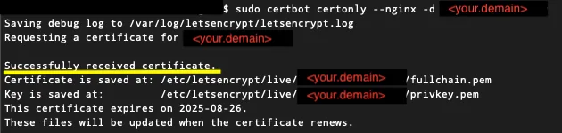

## 前言

現今因安全性問題大多的網路傳輸服務都會要求以 https 方式傳送 (ex: Line Bot Webhook、Google Cloud Redirect URL)，但去申請一個 SSL 憑證 每年需要繳維護費，對於個人使用者來說，這筆維護費可能就吃不消了。

剛好近期把個人網站建置好了，順便記錄一下申請 SSL 憑證 的過程，接下來我將一步步引導你透過 [Certbot](https://certbot.eff.org/) 向 [Let's Encrypt](https://letsencrypt.org/) 申請 免費 SSL 憑證 。

這篇文章將以Ubuntu 搭配 Nginx 為例，教大家如何透過 [Certbot](https://certbot.eff.org/) 申請 免費 SSL 憑證。

## 環境配置

-   作業系統：Ubuntu 22.04 LTS
-   Nginx 版本：1.18
-   Python 版本：3.10 (Certbot 將透過 pip 安裝)

## 什麼是 Certbot ?

Certbot 是一款由電子前哨基金會（Electronic Frontier Foundation, EFF）開發的**開源工具**，它的主要功用是**自動化獲取、安裝和更新 SSL/TLS 憑證**。

簡單來說，如果你想讓你的網站透過 HTTPS 加密連線，Certbot 可以幫你省去許多繁瑣的手動設定步驟。它會與 [Let's Encrypt](https://letsencrypt.org/) 這個免費憑證頒發機構合作，讓你的網站能夠輕鬆地啟用安全連線，提升資料傳輸的安全性。

## 如何安裝 Certbot ?

### 安裝系統依賴項

系統依賴項包含 Python 、Python venv 模組和 Apache 的插件 Augeas。

```bash
sudo apt update
sudo apt install python3 python3-venv libaugeas-dev
```

### 刪除 certbot-auto 相關軟體包

如果您之前有安裝過 certbot 相關的軟體包，請先使用以下的指令移除，避免套件產生衝突。

```bash
sudo apt remove certbot
```

### 建立 Python 虛擬環境

執行以下指令建立全新的 Python 虛擬環境，以避免與系統環境產生衝突。

```bash
sudo python3 -m venv /opt/certbot/
sudo /opt/certbot/bin/pip install --upgrade pip
```

### 安裝 Certbot

```bash
sudo /opt/certbot/bin/pip install certbot certbot-nginx
```

### 準備 Certbot 指令

將安裝在 Python 虛擬環境的 certbot 連結至指定目錄，以便後續的調用。

```bash
sudo ln -s /opt/certbot/bin/certbot /usr/local/bin/certbot
```

### 使用 Certbot 取得 SSL 憑證

```bash
sudo certbot certonly --nginx -d <your.domain>
```

`<your.domain>` 請替換成您自己的網域。

等待幾秒鐘後，便會出現 ”Successfully received certificate“ 等字眼，代表已經取得 Let's Encrypt 頒發 SSL 憑證了。



certbot 預設產生的路徑為 `/etc/letsencrypt/live/<your.domain>`，該目錄底下會有兩個檔案，分別為 `fullchain.pem` 及 `privkey.pem`，後續將這兩個檔案加入 nginx 設定檔即可。

## 設定自動續期 SSL 憑證

Let's Encrypt 頒發的憑證目前效期是 90 天，所以一定要讓系統自動執行 renew。用 pip 安裝的 Certbot 不會附 systemd timer，自動續期要自己加排程。

照 Certbot 官方的寫法，把排程寫進系統的 `/etc/crontab`：

```bash
echo "0 0,12 * * * root /opt/certbot/bin/python -c 'import random; import time; time.sleep(random.random() * 3600)' && sudo certbot renew -q" | sudo tee -a /etc/crontab > /dev/null
```

這行表示每天中午 12 點及午夜 12 點各執行一次 renew，前面那段 `time.sleep(random.random() * 3600)` 是隨機延遲最多一小時，避免大家同一時間打到 Let's Encrypt 伺服器。憑證還沒到期時 renew 什麼都不會做，所以一天跑兩次沒有關係。

加完之後，用 dry-run 模擬一次續期，確認整條流程走得通：

```bash
sudo certbot renew --dry-run
```

看到 `Congratulations, all simulated renewals succeeded` 就代表設定沒問題。

> 舊版本文教的 `crontab -e` 加那行寫法不會續期（使用者 crontab 沒有 `root` 欄、有 systemd 時條件也會跳過），照做過的請用 `sudo crontab -l` 檢查並刪掉，改用上面的寫法。

另外，pip 安裝的 Certbot 不會跟著系統更新，官方建議每個月手動升級一次：

```bash
sudo /opt/certbot/bin/pip install --upgrade certbot certbot-nginx
```

## Let's Encrypt 憑證要變短了：2027 年起 64 天

Let's Encrypt 已經公告會分階段縮短憑證效期：

-   2027-02-10 起：預設改發 64 天憑證，授權重用期從 30 天縮成 10 天
-   2028-02-16 起：再縮到 45 天，授權重用期縮到 7 小時

用上面那行 cron 一天跑兩次 `certbot renew` 的話，效期變短不需要改任何東西，Certbot 會自己判斷該不該續。要檢查的是自己寫的腳本：如果有寫死「到期前 30 天才續」「每 60 天跑一次」這類天數，到時候憑證會在腳本動手前就過期。可以 grep 一下自己的部署腳本有沒有 60、80、83 這類寫死的天數。

Let's Encrypt 也建議改用支援 ARI（ACME Renewal Information）的客戶端，由伺服器告訴客戶端什麼時候該續。Certbot 從 4.1.0 起支援 ARI，照上面每月升級就會拿到。

## 小結

以上是針對透過 Certbot 來產生 SSL 憑證，並設定 Let's Encrypt 自動續期。

可以參考這個 [Repository](https://github.com/haunchen/certbot-deploy)，提供你自動化部署的方法。

取得憑證後，可以進一步替 Nginx 設定快取策略，提升網站效能，請參考 [Nginx Cache WordPress 完整教學](/nginx-cache-wordpress/)。如果你是在 Ubuntu 上部署 Node.js 應用並需要啟用 HTTPS，也可以搭配 [Ubuntu 容器化 Node.js 部署教學](/nodejs-docker-ubuntu-containerization-tutorial/) 一起參考。

參考連結：

[Let's Encrypt 官方網站](https://letsencrypt.org/)

[Certbot 官方文件](https://certbot.eff.org/)

[Certbot 官方 pip＋Nginx 安裝說明](https://certbot.eff.org/instructions?ws=nginx&os=pip)

[Let's Encrypt：64-Day Certificate Lifetimes Coming Feb 2027](https://letsencrypt.org/2026/10/07/64-day-certs)

[Let's Encrypt：Decreasing Certificate Lifetimes to 45 Days](https://letsencrypt.org/2025/12/02/from-90-to-45)
