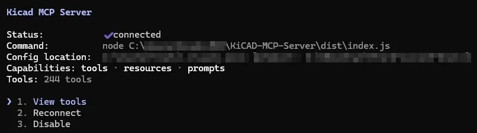
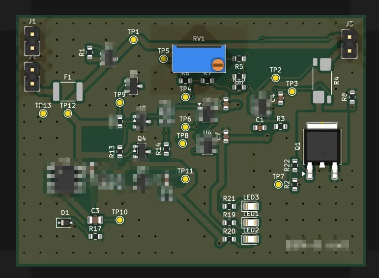
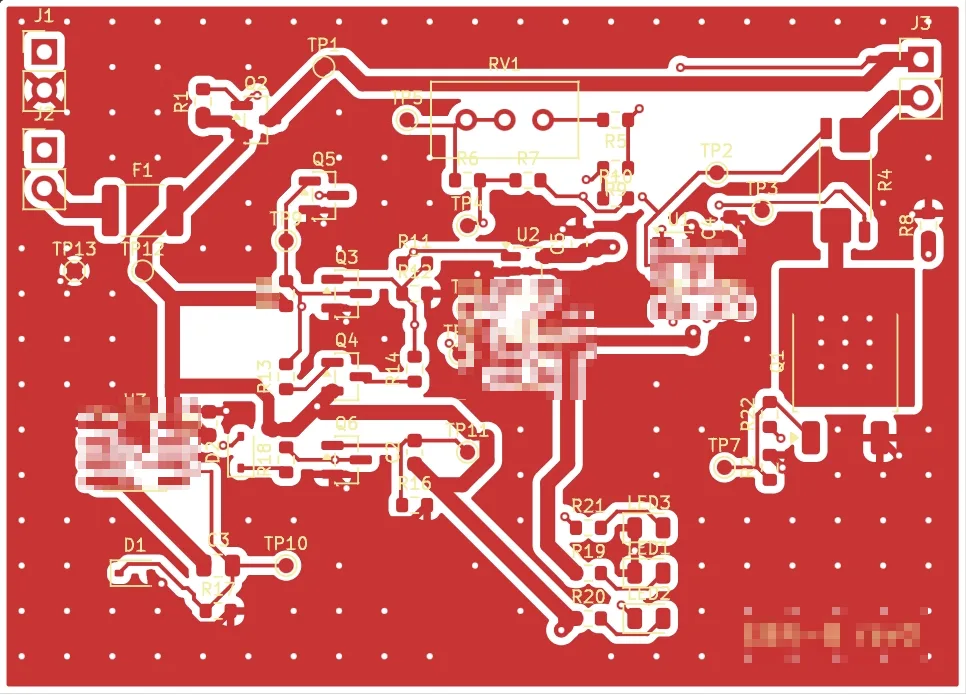
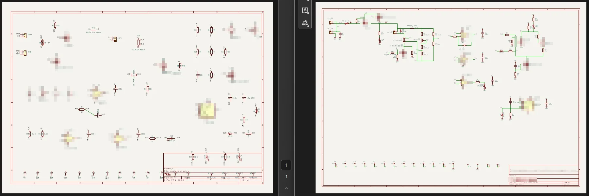

## 前言：檢查全過，原理圖上卻沒有線

AI 交回來的板子，ERC 0 違規，DRC 0 個未連接、0 個原理圖一致性問題。我打開原理圖，看了幾秒，只回了一句：

「原理圖怎麼沒有線啊。」

畫面上每支腳拉出一小段線，接一個網路名稱標籤，同名的標籤就算相連。KiCad 認得，DRC 也認得，但人看不出電流從哪裡走到哪裡。這種圖拿給同事審 layout，他第一件事就是退回來。

這篇記錄的是我第一次讓 Claude Code 接上 KiCad 10，把一塊類比電路板從原理圖畫到 PCB 的過程。板子規模不大：63 顆零件、33 個網路、64×46 mm 雙層。整段牆鐘大約 140 分鐘，我實際在線上大約一小時，中間兩次離開去做別的事，session 花費約 15 美元。全程我只打了 9 句話，KiCad 的視窗一次都沒開。

我自己平常就會畫板子，所以這次要看的不是「AI 能不能取代我畫」，而是它能接手到哪一步、哪一步一定要人看。結論先講：連線正確、DRC 乾淨這件事它做得到，而且做得很快；但「檢查全過」跟「能拿去用」中間還差一段，這段差距就是本篇大部分踩坑的來源。

後半段我把整個流程收成 Claude Code 的 skill，再做了一個唯讀的佈線審查 agent，那部分篇幅較長，拆到下一篇。

## 工具選型：最後的主力不是 MCP

一開始 Claude 提的方案是自己寫：用 SKiDL 寫網表，pcbnew Python API 擺零件，Freerouting 佈線。我回它：「找找有沒有大家已經在用的工具？」

它搜了一輪，改提這套：

- KiCad MCP server：讓 Claude 直接操作 KiCad 的原理圖與 PCB
- Freerouting：MCP 本身不佈線，佈線交給它
- FreeCAD 的 KiCad StepUp：之後做外殼干涉檢查用

KiCad MCP 有好幾支，我選 [mixelpixx/KiCAD-MCP-Server](https://github.com/mixelpixx/KiCAD-MCP-Server)：2874 星、MIT 授權、Windows／Linux／macOS 都支援，還有在維護。同一個作者另有新版 Konnect，用 Rust 寫、走 KiCad 10 原生的 IPC API，工具數量更多，但授權是 AGPL-3.0。這台是公司電腦，商用要另外買授權，所以這次沒選它。

先把結論放這裡，省得你以為 MCP 包辦一切：整段對話裡 MCP 工具只呼叫了 42 次，主要用在查符號腳位、放零件、連線、跑 ERC、出圖。真正扛起建板、佈線、鋪銅的，是 pcbnew Python 腳本加 `kicad-cli`。原因後面會一個一個講，簡單說就是好幾支 MCP 工具在 KiCad 10 上回報成功，結果沒有生效。

## 環境安裝（Windows）

我的環境：Windows 11、KiCad 10.0.6、KiCAD-MCP-Server 2.8.2（stable 分支）、Freerouting 2.5.0、Node 24。

### 安裝 KiCad 10

```powershell
winget install KiCad.KiCad --silent
```

大約三分鐘裝完。第一個坑馬上出現：winget 這次是裝在使用者目錄，不在 `C:\Program Files`。

```
C:\Users\<你>\AppData\Local\Programs\KiCad\10.0\
```

KiCad 附的 Python 3.11 就在 `bin\python.exe`，用它才 `import` 得到 `pcbnew`。後面所有腳本都要用這支 Python 跑，不要用系統的。

```powershell
& "$env:LOCALAPPDATA\Programs\KiCad\10.0\bin\python.exe" -c "import pcbnew; print(pcbnew.GetBuildVersion())"
```

### 補全域封裝庫表

如果你跟我一樣從來沒開過 KiCad 的 GUI，全域的 `fp-lib-table` 和 `sym-lib-table` 不會存在。這時 MCP 找不到任何庫，第一次跑 ERC 會冒出 130 條「目前的配置不包含封裝庫」這類警告。

從安裝目錄的範本複製過去就好：

```powershell
$k = "$env:LOCALAPPDATA\Programs\KiCad\10.0\share\kicad\template"
$dst = "$env:APPDATA\kicad\10.0"
New-Item -ItemType Directory -Force $dst | Out-Null
Copy-Item "$k\fp-lib-table", "$k\sym-lib-table" $dst
```

### 安裝 KiCad MCP

MCP 的 README 和平台指南寫的都是 KiCad 9.0，路徑也寫死 `C:\Program Files\KiCad\9.0`。實測 10.0.6 可以用，不必退版，只要用 `KICAD_PYTHON` 環境變數指到 KiCad 10 的 Python。

```powershell
git clone --depth 1 --branch stable https://github.com/mixelpixx/KiCAD-MCP-Server C:\Users\<你>\MCP\KiCAD-MCP-Server
cd C:\Users\<你>\MCP\KiCAD-MCP-Server
npm install
npm run build

# 用 KiCad 自己的 Python 裝 MCP 需要的套件
& "$env:LOCALAPPDATA\Programs\KiCad\10.0\bin\python.exe" -m pip install -r requirements.txt
```

註冊到 Claude Code：

```powershell
claude mcp add kicad --scope local `
  -e KICAD_PYTHON="$env:LOCALAPPDATA\Programs\KiCad\10.0\bin\python.exe" `
  -e NODE_ENV=production -e LOG_LEVEL=info -e KICAD_AUTO_LAUNCH=false `
  -- node C:\Users\<你>\MCP\KiCAD-MCP-Server\dist\index.js
```

我用 `--scope local` 而不是寫進專案的 `.mcp.json`，因為那個資料夾會同步到我的 Mac，裡面寫 Windows 路徑，Mac 那邊就會壞。原始碼也刻意放在同步資料夾外面。local scope 只記在這台機器、只對這個專案目錄生效，有一個副作用要知道：設定綁的是實際路徑，如果你從 symlink 開 session，會看不到這支 MCP。

註冊完要重開 session 或 `/reload-plugins` 才叫得到工具。在 Claude Code 裡打 `/mcp` 選 kicad，看到 connected 就是接上了，這版一共 244 個工具：



叫得到之後，可以請 Claude 跑 `get_backend_state` 確認：我這台回的是 `backend: swig`、`ipcConnected: false`，也就是走 pcbnew 的 SWIG 綁定，不是 KiCad 10 的 IPC API。這點會影響後面哪些工具靠得住。

### Freerouting 與 Java

Freerouting 2.5.0 要 Java 21 以上。Claude 一開始說「機器上已經有 Java 可以跑」，結果 MCP 的 `check_freerouting` 一查：

```json
"java": { "version": "java version \"17.0.12\" 2024-07-16 LTS", "version_ok": false, "java_21_ok": false },
"jar_found": false,
"ready": false
```

系統的 JDK 17 我不想動，所以另外下載一份可攜的 Temurin 25 JRE，跟 `freerouting-2.5.0.jar` 一起放在自己的工具資料夾。MCP 的 `autoroute` 工具要靠 `JAVA_HOME` 找 Java，而 MCP 的設定裡沒有這個變數，所以我乾脆不用 MCP 佈線，改由腳本直接呼叫：

```powershell
C:\Users\<你>\MCP\jre25\bin\java.exe -jar freerouting.jar -de board.dsn -do board.ses -mp 40 --gui.enabled=false
```

`-mp 40` 是最多跑 40 輪最佳化，`--gui.enabled=false` 讓它不開視窗。

## 從網表建板：PCB 不手動牽線

這是整套流程最重要的一個決定：原理圖是唯一的真實來源，PCB 從原理圖的網表建出來，不在 PCB 上手動牽任何一條線。

流程是這樣：

1. 用 MCP 在原理圖放零件、連線
2. `kicad-cli sch erc` 跑到 0 違規
3. `kicad-cli sch export netlist --format kicadxml` 匯出 XML 網表
4. 腳本讀網表建 `.kicad_pcb`，擺位、網路類別、外框另外從一份規格檔讀

```powershell
kicad-cli sch erc -o erc.rpt board.kicad_sch
kicad-cli sch export netlist --format kicadxml -o board.net.xml board.kicad_sch
```

為什麼不用 MCP 現成的 `sync_schematic_to_board`？因為它在目標 `.kicad_pcb` 還不存在時直接失敗：

```
"success": false,
"errorDetails": "pcbnew.LoadBoard failed or returned a dehydrated SWIG proxy that could not be recovered"
```

自己寫建板腳本不難，核心就是讀網表裡每顆零件的 footprint 和每支腳的網路，用 pcbnew 放上去。但有兩個細節沒做好，DRC 的原理圖一致性檢查（`--schematic-parity`）會整片紅。

### 坑：網路名稱的「/」不能去掉

我第一次建出來的板子，parity 報了 214 個問題，其中 137 個是這種：

```
[net_conflict]: Pad net (XXX) doesn't match net given by schematic (/XXX)
```

KiCad 原理圖裡的本地標籤，網路名稱前面會帶一個 `/`（代表根頁面）。腳本為了好看把它去掉，parity 就認為每支腳都接錯網路。網路名稱一律照網表原文。

### 坑：footprint 要綁原理圖符號的 UUID

另外 63 個 `footprint_symbol_mismatch` 類的問題，是因為 footprint 沒有記錄自己對應哪個原理圖符號。少了這一步，DRC 會把每顆零件都當成多出來的。

```python
fp.SetPath(pcbnew.KIID_PATH("/" + c.findtext("tstamps")))
fp.SetSheetname("Root")
fp.SetSheetfile(name + ".kicad_sch")
```

`tstamps` 是網表 XML 裡每顆零件的符號 UUID。補上這兩件事，再把沒接東西的腳也建成 unconnected 網路，parity 問題從 214 降到 0。

### 坑：create_netclass 回報成功，但沒套上

我用 MCP 的 `create_netclass` 建了一個電源網路類別，線寬 1.0 mm。回傳是這樣：

```json
"success": true,
"persisted": true,
"warning": "in-memory NETCLASS update failed: 'NETINFO_ITEM' object has no attribute 'SetClass'"
```

`success: true`，只有一條 warning。Freerouting 跑完 0 unrouted、0 violations，看起來一切順利，直到檢查電源網路才發現 `class: Default`，線寬還是預設的 0.25 mm。

它只把設定寫進 `.kicad_pro`，記憶體裡的板子沒套用。改在建板腳本裡直接設：

```python
ds = board.GetDesignSettings()
ns = ds.m_NetSettings
nc = pcbnew.NETCLASS("Power")
nc.SetTrackWidth(pcbnew.FromMM(1.0))
nc.SetClearance(pcbnew.FromMM(0.25))
ns.SetNetclass("Power", nc)
ns.SetNetclassPatternAssignment("<電源網路名稱>", "Power")
board.SynchronizeNetsAndNetClasses(True)
```

> MCP 工具回報 success 不代表生效。凡是會影響後續步驟的設定，做完都要從板子實際讀回來確認一次。

同一類問題還有 `save_board`：用 MCP 存檔，會把設計規則的最小線寬改回 0.2 mm，接著跑 DRC 冒出一堆 `track_width` 違規。所以 PCB 我一律用 pcbnew 腳本存，不經過 MCP。

### 坑：batch_connect 逾時，原理圖變成 0 bytes

放完 67 個符號，Claude 用 `batch_connect` 一次把所有連線送出去。30 秒後：

```
Command timeout after 30s: batch_connect
```

更糟的是原理圖檔案變成 0 bytes，所有零件都不見了，背景還留著一支沒結束的 KiCad Python 行程。

重來的做法：刪掉空檔、重新放零件、先備份一份，再把連線切成 7 小批，每批十幾個，每批 10～20 秒，全部成功。

> KiCad MCP 的批次工具有 30 秒逾時。每批控制在 10 個零件左右，動手前先備份 `.kicad_sch`。

## Freerouting 自動佈線與 DRC 收斂

建好板之後的佈線流程，全部在一支 pcbnew 腳本裡完成：

```python
assert pcbnew.ExportSpecctraDSN(board, dsn)
subprocess.run([java, "-jar", freerouting_jar, "-de", dsn, "-do", ses,
                "-mp", "40", "--gui.enabled=false"], timeout=1200)
assert pcbnew.ImportSpecctraSES(board, ses)
```

匯出 DSN、Freerouting 佈線、匯回 SES。這塊板子每次大約 10～40 秒。



DRC 的收斂過程大概是這樣，第一版是還沒有原理圖、直接照接線表建的試畫版：

| 階段 | 違規 | 未連接 |
|------|------|--------|
| 第一次佈線 | 130 | 10 |
| GND 加粗、板子加高 2 mm | 98 | 4 |
| 調最小線寬、GND 改佈線後才鋪 | 71 | 0 |
| 補庫表、從原理圖網表重建 | 28 | 1 |
| 縫合孔、清 dangling via | 25 | 0 |
| 最終 | 21（全是絲印） | 0 |

最後剩的 21 條是絲印重疊和絲印壓到銅，只是 warning，要在 KiCad 裡手動拖。中間我試過把參考編號縮到 0.7 mm 想一次解決，結果換來 62 條 `text_height` 違規，退回 0.8 mm。

跑 DRC 的指令：

```powershell
kicad-cli pcb drc --schematic-parity --refill-zones --save-board -o drc.rpt board.kicad_pcb
```

要注意 `--refill-zones` 不加 `--save-board` 時只會在記憶體裡重鋪，之後讀檔案的腳本量到的還是舊的鋪銅。

### 坑：鋪銅順序會把 GND 切碎

第一版我先把正反兩面的 GND 都鋪好，再丟給 Freerouting。結果它把 GND 當成一般網路，拉出總長 258 mm 的細線，這些細線再把銅箔切成一塊一塊的島。

正確順序：

1. 佈線前只放背面的 GND 鋪銅，Freerouting 會把它當成 plane，在每個 GND 焊墊旁邊直接打孔下去
2. 佈線完成後，才補正面 GND 和其他散熱銅
3. 最後打縫合孔把兩面接起來

改完之後，GND 從 258 mm 的細線變成整片鋪銅，只剩 74 mm 的短走線。

### 坑：Freerouting 會把線收窄

佈完線 DRC 冒出這種：

```
[track_width]: 走線寬度 (電路板中的約束 最小寬度 0.2000 mm; 實際 0.1250 mm)
```

Freerouting 進 SOT-23 這類細腳距焊墊時會把線收窄，最窄到 0.125 mm。我把板子的最小線寬設成 0.12 mm，板廠的極限是 0.1 mm，還有餘裕。

### 坑：dangling via 和縫合孔

Freerouting 的最佳化會留下只接一層的過孔（`via_dangling`），我這塊板子有 8 個。腳本在匯回 SES 之後掃一遍，非 GND、沒鎖定、只接單層的過孔直接刪掉。

縫合孔一開始用 MCP 的 `add_gnd_stitching_vias`，工具本身能用，放了 115 顆，但之後只要靠 MCP 存檔就會中上面線寬下限被改回去的問題。最後改成腳本自己放：每 3 mm 一格，只在正反兩面的 GND 鋪銅都完整包住「過孔加間距」的位置才放，這樣縫合孔永遠碰不到別的網路。最終放了 121 顆。



## DRC 管規則，管不到品質

DRC 歸零只代表沒有違反規則，不代表佈得好。所以我請 Claude 照最佳實踐重新審一次佈線，它寫了一支 `audit.py`，把「佈得好不好」量成數字。第一輪量出來的問題：

- GND 有 258 mm 是細線（就是上面鋪銅順序那個問題）
- 一個高阻抗節點的走線長 81 mm，這種節點越長越容易拾取雜訊
- 有一顆去耦電容離 IC 電源腳 4.8 mm

改擺位之後重量：高阻抗節點從 81 mm 壓到 30 mm，幾條類比感測線從 50～80 mm 降到 18～36 mm，去耦電容全部在 2.5 mm 以內。測試點也從板邊搬到各自量測的節點旁邊，不然一條拉到板邊的測試線就把前面縮短的努力抵消了。

這幾項 DRC 都不會報，要另外量。

> Freerouting 每次跑的結果都不一樣，線長會差幾 mm。只要重跑佈線，audit 就要重新量一次。

## 回到開頭：原理圖要有真的線

現在回到那句「原理圖怎麼沒有線啊」。

原因出在 MCP 的 `batch_connect`：它的連線方式是每支腳拉一小段線、接一個網路標籤，回傳訊息是 `Placed N label(s)`。這種原理圖連線完全正確，ERC 0 違規、parity 0 問題，但人讀不了。Claude 交付時其實提過一句「這版原理圖是用網路標籤接線的」，只是我那時沒注意，打開圖才發現。

重畫時的規則：

- 同一個區塊內用真的導線接
- 網路標籤只用在跨區的訊號
- 電源和地用電源符號

重畫最怕的是把連線改錯。我的做法是先把重畫前的網表存一份當基準，重畫後再匯出一份，用網路的「成員集合」比對，不比網路名稱，因為重畫後 KiCad 會自動幫沒命名的網路取新名字：

```python
def nets(path):
    out = {}
    for n in ET.parse(path).getroot().find("nets"):
        members = frozenset((x.get("ref"), x.get("pin"))
                            for x in n if not x.get("ref").startswith("#"))
        if members:
            out[members] = n.get("name").lstrip("/")
    return out
```

兩邊的成員集合完全一樣才印 `MATCH`。這次重畫跑了三次：

```
MISMATCH 33 36
MISMATCH 33 34
MATCH 33 33
```

第一次是兩顆電阻的方向和腳位寫反，第二次是其中一顆還有一支腳懸空。如果只看圖，這兩個錯我不一定看得出來。「圖好不好看」和「連線對不對」要分開驗，後者交給比對腳本。

重畫時每顆符號都保留原本的 UUID，所以 PCB 不用重新佈線，只要把 PCB 上的網路名稱改成新名字就好，之前審過的走線、鋪銅、散熱孔都不用動。



### 原理圖疊字

有線的原理圖畫出來之後，還有一堆文字疊在線上。MCP 有 `autoplace_schematic_fields`，回報：

```
Auto-placed fields for 63 component(s) (126 fields updated).
```

重新出圖一看，轉過方向的元件幾乎沒變。原因是欄位的角度相對於元件本身，元件轉 90°，標號跟著變直的，剛好壓在導線上。要手動設：

- 轉 90°／270° 的元件，欄位要設 `angle: 90` 才會橫著顯示，設 0 反而是直的
- 轉 180° 或鏡像的元件，`justify` 的左右會反過來，要反著設

用 `batch_set_schematic_property_positions` 和 `batch_edit_schematic_components` 分批改，改完出局部圖確認，最後再跑一次網表比對，確定只動到文字、沒動到連線。

## 常見問題

### KiCad 10 能用 KiCad MCP 嗎？

可以。mixelpixx 版文件寫 KiCad 9，實測 10.0.6 正常，用 KICAD_PYTHON 指到 KiCad 10 附的 Python 即可。

### Freerouting 一直顯示找不到 Java？

Freerouting 2.5.0 要 Java 21 以上。另放一份可攜 JRE，腳本直接用它跑 java -jar，不必動系統 Java。

### 用 MCP 存檔後 DRC 冒出大量線寬違規？

save_board 會把最小線寬改回 0.2 mm。PCB 改用 pcbnew 腳本存檔，最小線寬在腳本裡設。

### ERC 和 DRC 全過，可以直接送廠嗎？

不行。還要量佈線品質、看原理圖人讀不讀得懂、確認型號都定了，最後請人審 layout。

## 結語：它能做到哪、哪裡還得人看

這次 Claude 做到的：從接線表到有連線的原理圖、從網表建板、自動佈線、鋪銅、縫合孔，DRC 0 未連接、0 原理圖一致性問題，外加 3D 渲染和 STEP。我沒開過一次 KiCad 視窗。

還得人看的：原理圖讀不讀得懂（這次就是我看一眼才發現的）、佈線品質的門檻怎麼定、哪些零件型號還沒定。這塊板子目前還沒送打樣，送之前我會先請同事看過 layout。

如果你要試，我的建議只有一條：把 MCP 當成查詢和小改的工具，建板、佈線、存檔這些會影響整塊板子的動作交給 pcbnew 腳本，每一步都用 DRC 加網表比對驗證。MCP 回報 success 之後，從板子實際讀回來確認一次。

下一篇會寫怎麼把這整套流程收成 Claude Code 的 skill，以及為什麼佈線審查要另外做成一個唯讀的 agent。那次試跑，審查 agent 反過來抓出了審查規則本身的 12 個問題，其中一個還推翻了我們前面「都合格」的結論。
