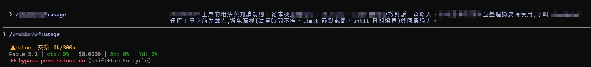
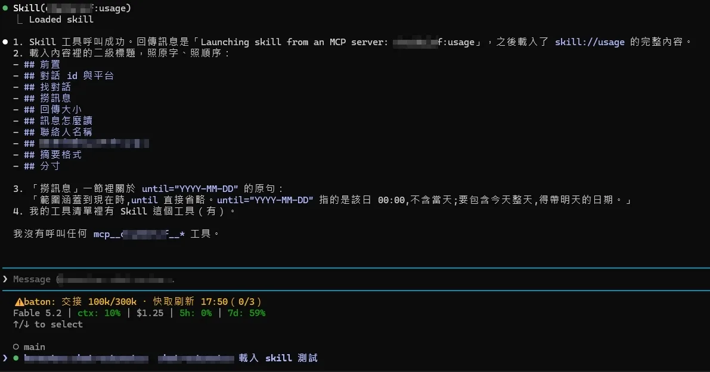

> 實測版本：Claude Code 2.1.332、python-sdk commit `9a754b0`（2026-11）

我有一支自己寫的 MCP server，用途是讀本機幾個通訊軟體桌面版的聊天紀錄，讓 Claude 幫我整理摘要。這篇用 chatlog 代稱它。每天上班、下班，都有 subagent 拿它撈訊息、抽出誰要我做什麼。

工具本身不難用，難的是「怎麼用才不會漏」。清單上的最後訊息時間不準、`limit` 回滿了不會告訴你有截斷、`until` 帶今天日期會把今天整天切掉，這些規則我寫成說明文件，一份放在上班交班那支 subagent 的參考檔，一份放在整理社群群組的 skill 裡。

問題就出在「兩份」。server 那邊改了行為，說明文件不會自己跟著改。今天回頭對了一次，交班那份就有兩條已經過時：一條說某個平台的官方帳號讀不到（早就讀得到了），一條把日期邊界的時區寫錯。subagent 照著舊規則跑，不會報錯，只會默默抓少。

剛好 11 月 24 日 Anthropic 發表了 Skills over MCP：MCP server 除了提供 tools，也能把 skill 一起發布出去。這正好是我缺的那塊：說明書跟著 server 走，server 更新，說明書就一起更新。

所以我花了一個下午，幫 chatlog 加上一個 skill。這篇是完整紀錄，包含兩次差點下錯結論的地方。

---

## Skills over MCP 是什麼

一句話：MCP server 可以在 tools 之外，再提供一份或多份 skill。Claude 平常只看到 skill 的名稱和描述，真的需要時才載入全文，所以不會一直佔著 context。

它跟你可能已經在用的一般 skill、MCP tools 差在哪，用表格看比較快。

| | 一般 skill | MCP tools | MCP server skill |
|---|---|---|---|
| 放在哪 | 本機 `.claude/skills/` 或 plugin | MCP server | MCP server |
| 內容 | 做事的流程與知識 | 可以呼叫的動作 | 怎麼用這個 server 的流程與知識 |
| 誰維護 | 使用者自己 | server 作者 | server 作者 |
| 更新方式 | 自己改檔 | 更新 server | 更新 server，skill 跟著更新 |

規格名稱是 SEP-2640，擴充 ID 是 `io.modelcontextprotocol/skills`。協定上的長相大概是這樣：

- server 在 `server/discover` 的 capabilities 宣告自己支援 skills
- client 用 `skills/list` 列出 skill、用 `skills/get` 取單一個
- skill 的檔案本身就是普通的 MCP resource，URI 慣例是 `skill://<名稱>/SKILL.md`
- 每個檔案要附 sha256 digest 和大小，client 讀回來會比對

skill 的格式跟你熟悉的 Agent Skills 一樣：一個資料夾，裡面一份 `SKILL.md`，開頭是 YAML frontmatter，至少要有 `name` 和 `description`。有一條規格要注意：資料夾名稱（URI 裡的那一段）必須跟 `name` 一致。

---

## 事前準備：先確認你的環境用得到

這一節我放在實作前面，因為條件比想像中窄，而我在這裡踩的坑讓我誤判了兩次。

### Claude Code 端

- 版本 2.1.331 以上（我用 2.1.332）
- Pro、Max、Ultra 方案預設開啟；Team 要管理員到後台開；Enterprise 官方說即將推出
- 只在互動終端機生效。`claude -p`、cloud session、remote-control server mode、GitHub Actions、Agent SDK 都不支援

最後一條我一定要再講一次，因為它害我白忙一輪。我們一開始用 `claude -p` 跑自動化測試，server 明明連上了、也用新版協定，但 init 事件裡的 skills 和 slash commands 就是沒有它。當時翻 Claude Code 的程式碼，看到 feature flag，就推論「這個帳號還沒輪到」。

結果是我自己拿官方文章的截圖去對，Ultra 方案應該預設開啟才對，回頭查才找到官方 headless 文件裡白紙黑字寫著：

> Skills from MCP servers aren't supported.

所以驗證 server skill 一律開一個新的互動 session 來測，`-p` 測不到不代表功能沒開。

### Python SDK 端

這是第二個要知道的事：PyPI 上最新的 `mcp` 2.3.0 還沒有 skills。

python-sdk 的 skills 支援（PR #3485）是 2026 年 10 月 11 日合併的，但 2.3.0 在 10 月 2 日就發了，所以要用只能直接裝 GitHub 上的 commit。我選的是那個 PR 的合併點 `9a754b0`，它只比 2.3.0 多兩個 commit，差異最小；追 main 的最新版則多了二十幾個 commit，風險沒必要扛。

`requirements.txt` 要寫兩行，只寫第二行會裝不起來：

```text
mcp-types @ git+https://github.com/modelcontextprotocol/python-sdk@9a754b0aabb873d9707d52dc165b569fb442ec8c#subdirectory=src/mcp-types
mcp @ git+https://github.com/modelcontextprotocol/python-sdk@9a754b0aabb873d9707d52dc165b569fb442ec8c
```

原因是 `mcp` 依賴同一個 repo 裡的 `mcp-types`，版本是 `2.3.1.dev2+9a754b0` 這種開發版，PyPI 上根本沒有，pip 找不到就直接失敗。

等 SDK 正式發版，把這兩行換回版本號就好，程式碼不用改，因為用的就是同一套官方 API。

### 升級後還在走舊協定？

如果你的 server 是從舊版 SDK 升上來的，可能會遇到這個：SDK 升完、`/mcp` 重連，debug log 還是寫著：

```text
remembered as a legacy peer from an earlier connect (its server/discover probe was answered method-not-found or not at all); skipping the probe
```

連線資訊裡的 `protocolEra` 也還是 `legacy`。skills 是靠 `server/discover` 宣告的，跳過探測就等於 client 看不到你的 skill。

原因是 Claude Code 會記住「這個 server 上次沒回應 `server/discover`」，記在這個檔：

```text
~/.claude/state/mcp-discover-verdicts.json
```

我從 Claude Code 2.1.332 的程式碼翻到的規則是這樣：每個 server 依啟動指令、參數、環境變數、專案目錄算一個鍵，stdio 類型的記 7 天；每個 Claude Code 程序只在第一次用到時讀一次，之後都用記憶體裡的版本。

所以處理方式是刪掉檔案裡對應的那一筆（或整個清成 `{}`），然後開一個新的 session。在舊 session 裡重連沒用，它記憶體裡還是舊的判定。debug log 看到 `"protocolEra":"modern"` 才算真的走上新協定。

> debug log 在 Windows 的位置是 `%LOCALAPPDATA%\claude-cli-nodejs\Cache\<專案路徑>\mcp-logs-<server 名稱>\`。

---

## 實作：幫 chatlog 加上 usage skill

### 先決定 skill 裡放什麼

我的判準是：跟 server 本身綁在一起、換誰來用都成立的規則，才搬進 server；跟我個人或公司流程有關的，留在原本的地方。

搬進去的是這些：

- 對話 id 一律是 `<平台>:<原生 id>`，照清單回的值原樣傳，不要自己拼
- 清單上的最後訊息時間不能拿來判斷有沒有新訊息，要直接撈
- `since` 一定要自己帶，不帶會拉出整段歷史
- `get_history` 回滿 `limit` 時沒有截斷標記，要自己用最後一則的時間續撈
- 哪些呼叫的回傳會超過 Claude Code 的 5 萬字元上限，被轉成檔案
- 撤回訊息、語音、卡片這些非文字內容怎麼讀

留在原處的是交班格式、怎麼判斷一則訊息是不是「要我做的事」這類流程規則。

最後整理成一份 `SKILL.md`，大約 90 行：

```markdown
---
name: usage
description: chatlog 工具的用法與判讀規則。從本機通訊軟體桌面版撈對話、聯絡人、日程與郵件並整理摘要時使用；呼叫 chatlog 任何工具之前先載入，避免漏抓與回傳過大。
---

# chatlog 用法

## 前置
- 對應的 App 要開著……
```

`description` 很重要，Claude 靠它判斷什麼時候要載入。我在最後加了一句「呼叫任何工具之前先載入」，讓它別等到踩坑才想起來。

### 把 SKILL.md 包進套件

我把檔案放在 `src/chatlog/skills/usage/SKILL.md`，跟著 Python 套件走，`pyproject.toml` 要記得加 package-data，不然打包出來的 wheel 裡沒有它：

```toml
[tool.setuptools.package-data]
chatlog = ["skills/*/SKILL.md"]
```

### server 端註冊

SDK 提供的是協定這一層：處理 `skills/list`、`skills/get` 的請求、在 capabilities 宣告擴充、驗證 skill 符不符合規格。它不會幫你從資料夾讀檔、算 hash，這部分要自己寫（從資料夾讀的功能在另一個 PR，還沒合併）。

精簡後的寫法如下：

```python
import hashlib
from importlib import resources
from typing import Any

from mcp.server.context import ServerRequestContext
from mcp.server.mcpserver import MCPServer
from mcp.server.mcpserver.resources import TextResource
from mcp.server.skills import Skills
from mcp.shared.exceptions import MCPError
from mcp.shared.skills import (
    GetSkillParams, GetSkillResult, ListSkillsParams, ListSkillsResult,
    Skill, SkillResource,
)
from mcp.types import INVALID_PARAMS

SKILL_URI = "skill://usage/SKILL.md"

data = resources.files("chatlog").joinpath("skills", "usage", "SKILL.md").read_bytes()
text = data.decode("utf-8")

skill = Skill(
    uri=SKILL_URI,
    frontmatter={"name": "usage", "description": "chatlog 工具的用法與判讀規則……"},
    resources=[SkillResource(
        uri=SKILL_URI,
        digest="sha256:" + hashlib.sha256(data).hexdigest(),
        size=len(data),
    )],
)

async def list_skills(ctx: ServerRequestContext[Any, Any],
                      params: ListSkillsParams) -> ListSkillsResult:
    return ListSkillsResult(skills=[skill])

async def get_skill(ctx: ServerRequestContext[Any, Any],
                    params: GetSkillParams) -> GetSkillResult:
    if params.uri != skill.uri:
        raise MCPError(code=INVALID_PARAMS, message=f"unknown skill: {params.uri}")
    return GetSkillResult(skill=skill)

mcp = MCPServer("chatlog", extensions=[Skills(list_skills=list_skills, get_skill=get_skill)])
mcp.add_resource(TextResource(uri=SKILL_URI, name="SKILL.md",
                              mime_type="text/markdown", text=text))
```

三個重點：

- `Skills(...)` 要在建構 `MCPServer` 時用 `extensions=` 傳進去，宣告才會出現在 capabilities 裡
- `get_skill` 就算某個 skill 沒列在 `list_skills` 裡，也要能依 URI 回答，這是規格要求的
- digest、size 和實際送出去的 resource 內容要來自同一份 bytes。這裡為了好讀把 frontmatter 寫死，chatlog 實際上是從檔案自己解析，避免改了 SKILL.md 卻忘了改程式碼，兩邊對不上

另外我加了一層保護：SKILL.md 讀不到或格式錯了，server 照常啟動，只是這次不宣告 skills 擴充。說明書壞掉不該拖累工具本身。

---

## 在 Claude Code 驗證

開一個新的互動 session，連上 server 後打 `/`，選單裡會出現 `/chatlog:usage`，格式是 `/<server 名稱>:<skill 名稱>`，後面帶著 skill 的 description。



debug log 裡會看到這兩行，代表 client 真的去要了清單：

```text
MCP server "chatlog": Found 1 skill via skills/list
[mcp-skills] Listed 1 skills from MCP server 'chatlog'
```

---

## subagent 讀不到？少的只是一個 Skill 工具

這段是整個過程我印象最深的。

主 session 測通之後，接著要測 subagent。chatlog 每天被呼叫最多次的，就是那支上班交班用的 subagent，它讀不到的話，這件事等於白做。它的工具清單長這樣：

```yaml
tools: mcp__chatlog__list_platforms, mcp__chatlog__list_conversations, mcp__chatlog__get_history, mcp__chatlog__list_schedules, mcp__chatlog__get_contacts, Read
```

我們先做了一個測試用的 subagent，工具組比照它：一個 MCP 工具加 Read。結果它的系統提示裡完全沒有 skill 清單，試著用 Read 讀 `skill://probe-usage/SKILL.md`、讀本機 `.claude/skills` 的路徑，全部回「File does not exist」。

當時的結論是「server skill 進不到 subagent」，chatlog 這邊不做了，連交辦都先停了。

後來換個方向想：主 session 是用 Skill 工具載入 skill 的，那 subagent 是不是只是沒有這個工具？把測試 subagent 的工具清單改成：

```yaml
tools: mcp__skilltest__ping, Read, Skill
```

開新 session 重測，subagent 的 skill 清單立刻出現 `skilltest:probe-usage`，載入後讀到的內容完全正確，debug log 也留下了這一行：

```text
Loaded MCP skill 'probe-usage' from skill://probe-usage/SKILL.md
```

那一場主 session 沒有載入過這個 skill，所以這行是 subagent 自己載的。



結論是：subagent 的 `tools` 有寫白名單時，要把 `Skill` 加進去。官方文件只寫了「tools 省略 Skill，subagent 就不能呼叫 skill」，沒寫 MCP server 的 skill 也受這條管，這就是我差點下錯結論的原因。

這個實驗還帶出一個設計決定。Skill 載入時，會指示 agent 用 `ReadMcpResourceTool` 去讀 skill 的附屬檔案，而我的 subagent 沒有這個工具。與其再幫它開一個讀 resource 的權限，我選擇讓 chatlog 的 skill 只有一份 `SKILL.md`、不帶任何附屬檔。

最後，交班 subagent 的定義改了兩處：tools 加上 `Skill`，內文加一句「第一次呼叫 chatlog 工具前，先用 Skill 載入 `chatlog:usage`」。光給工具不講，它不一定會想到去載。

---

## 常見問題

### 打 / 看不到 /server:skill 怎麼辦？

確認用互動終端機而非 `-p`、版本 2.1.331 以上、debug log 顯示 protocolEra 為 modern。

### subagent 叫不到 server skill？

subagent 的 tools 若有白名單，要加上 Skill；skill 帶附屬檔的話還需要 ReadMcpResourceTool。

### 一定要等 Python SDK 發版嗎？

不用，鎖 python-sdk 的 commit 就能用，requirements 要同時寫 mcp-types 與 mcp 兩行。

---

## 結語

做完回頭看，Skills over MCP 最適合放的是「工具層」的規則：參數的坑、回傳的限制、資料怎麼解讀。這些規則換誰來用都一樣，本來就該由 server 作者維護。至於「拿這些資料做什麼」的流程，還是留在你自己的 skill 或 agent 裡。

對 server 作者來說，這也改變了文件的寫法。以前 README 寫給人看，現在 SKILL.md 寫給 Claude 看，要寫的是「什麼情況下會出錯、出錯時長什麼樣子」，而不是功能介紹。

我這邊的下一步，是等交班 subagent 實際跑幾天、確認它每次都有先載入 skill，再把原本那兩份重複的說明刪掉。到那時候，這些規則就只剩 server 裡的一份了。

---

## 參考資料與延伸閱讀

- [MCP servers can now ship skills, run tasks, and more with Claude](https://claude.com/resources/articles/skills-over-mcp-tasks-and-more)：Anthropic 2026-11-24 的發表文章
- [Skills extension overview](https://modelcontextprotocol.io/extensions/skills/overview)：SEP-2640 規格說明
- [python-sdk PR #3485：Add Skills extension](https://github.com/modelcontextprotocol/python-sdk/pull/3485)：Python SDK 的 skills 實作
- [Claude Code MCP 文件](https://code.claude.com/docs/en/mcp)：「Use skills from MCP servers」一節與 MCP skill 的可用情境
- [Claude Code headless 文件](https://code.claude.com/docs/en/headless)：`-p` 模式不支援 MCP server skill 的出處
