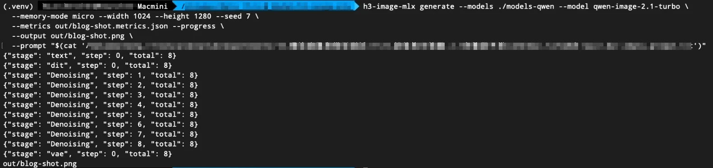
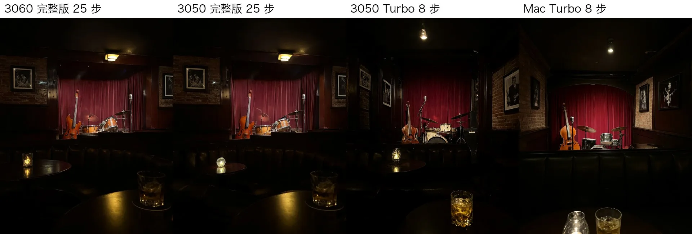
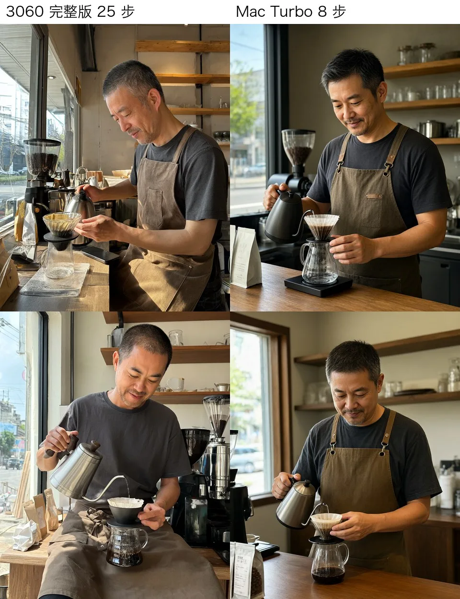

## 前言：只為了生圖，值得買一張顯卡嗎

本地跑 AI 生圖，大家的預設答案是買 NVIDIA 顯卡。我手上剛好有三台機器可以比：一台 Mac mini M4 Pro 24GB、一台 RTX 3060 12GB 的 Windows 桌機、一台 RTX 3050 8GB 的 Windows 桌機。我想用實測數字回答一個問題：如果你只有 Mac，要不要為了生圖再買一張顯卡？

讓我想測的是 h3-image-mlx 這個套件。它在 Apple Silicon 上跑 MiniMax H3 和 Qwen Image 2.1 Turbo，做法是權重不整個載進記憶體，去噪時從 SSD 一個區塊一個區塊讀。8-bit 權重將近 18GB 的模型，24GB 的 Mac 也跑得動。

結論先講：

- Mac mini 跑 Qwen Image 2.1 Turbo，1024×1280 一張約 3 分鐘，生圖行程記憶體峰值不到 2GB，其他程式的記憶體很寬裕
- 同樣的 Turbo，8GB 的 RTX 3050 一張 24 秒，12GB 的 3060 一張 17 到 19 秒
- 偶爾出幾張圖，Mac 夠用；要批次出圖，買張 8GB 獨顯的效益很明顯
- 硬碟九成時間都在讀，但平均只讀 300MB/s 左右，換更快的 SSD 幫助有限
- 讀取不會磨損 SSD，要注意的是 swap

## 測試環境

Mac 這邊：

- Mac mini M4 Pro、24GB 統一記憶體、macOS 26.6.2
- Python 3.13
- h3-image-mlx 0.1.0a8，加上 Qwen 專用的 `h3-image-mlx-qwen-runtime` 0.1.0a1
- 權重是 `ddalcu/Qwen-Image-2.1-Turbo-MLX-Serve-8bit`，15 個檔共 17.7GB，放在 Thunderbolt 4 外接的 PCIe SSD

M1 到 M4 走的是套件的 portable MLX backend，M5 以後預設走另一條 W8A8 的路，官方 H3 的數字在 M5 上快很多。這篇的數字只代表 M4。

兩台 Windows 對照機都跑 ComfyUI，權重是 Comfy-Org 的 int8 ConvRot 版：

- RTX 3060 12GB
- RTX 3050 8GB（OEM 版，Ryzen 7 5800X、32GB RAM）

三台用同一段 prompt、同樣的 seed 7 和 42，尺寸 1024×1280，不掛任何 LoRA。3050 只跑了場景那組。

## 原理：24GB 怎麼跑將近 18GB 的模型

一般在 Mac 上用 ComfyUI 跑生圖，文字編碼器、去噪模型（DiT）、VAE 三個都要載進記憶體。Qwen Image 2.1 的 8-bit 權重加起來 17.7GB，24GB 的 Mac 扣掉系統和瀏覽器，空間很緊。

h3-image-mlx 從三個地方省記憶體：

1. 三個階段拆成三個獨立行程輪流跑。文字編碼跑完存結果、行程結束釋放記憶體，再換去噪，最後換 VAE。三個模型不會同時待在記憶體裡
2. 去噪時權重留在 SSD，跑到哪個 transformer block 才讀那一塊進來，每一步都重新要一次。記憶體有空的時候，macOS 的系統快取會接住一部分，不一定每次都真的碰到硬碟
3. VAE 分塊解碼，高解析度也不會一次吃掉一大塊記憶體

這三點是官方 README 對 H3 的說明。Qwen 這條線我從 `--metrics` 看得到前兩點：文字編碼、去噪、VAE 確實是三個階段分開跑，各自記錄峰值。

Qwen 有四種記憶體模式：`resident`、`prefetch`、`micro-fast`、`micro`。官方文件沒有逐一說明，從名稱和原始碼看，`resident` 把權重留在記憶體，另外三種都是串流，差在緩衝區大小和要不要預讀。我只測了 `micro` 和 `micro-fast`。

官方 README 有一組 H3 在 M5 Pro 48GB 上的數字：串流加上預讀與非同步計算，1024×1024 跟權重全留在記憶體一樣快（23.61 秒對 23.63 秒），行程峰值從 21.18GB 降到 3.23GB。那是 M5 走快路的結果，M4 上我沒有做同樣的對照。

## 安裝與四個坑

```bash
python3 -m venv .venv
source .venv/bin/activate
pip install 'h3-image-mlx==0.1.0a8' 'h3-image-mlx-qwen-runtime==0.1.0a1'
h3-image-mlx fetch --source huggingface --models ./models-qwen --model qwen-image-2.1-turbo
h3-image-mlx verify --models ./models-qwen --model qwen-image-2.1-turbo
```

兩個套件都還在 alpha。上面釘的是我測的版本，PyPI 上 h3-image-mlx 已經出到 0.1.0a9。

`fetch` 預設從 ModelScope 下載，在台灣我改用 `--source huggingface`，共 17.7GB。`verify` 會比對檔案雜湊，下載中斷過的話建議跑一次。

出一張圖：

```bash
h3-image-mlx generate --models ./models-qwen --model qwen-image-2.1-turbo \
  --memory-mode micro --width 1024 --height 1280 --seed 7 \
  --metrics out/jazz.metrics.json --progress \
  --output out/jazz.png --prompt "$(cat jazz.prompt.txt)"
```

`--metrics` 會把每個階段的耗時、記憶體峰值、磁碟讀取量寫成 JSON，下面的數字都是從這裡來的。



### 坑一：沒裝 runtime，0.65 秒就退出

Qwen 的去噪跑在一個原生 worker（`qwen-stream-probe`，84MB）裡，它包在另一個套件 `h3-image-mlx-qwen-runtime`。只裝 `h3-image-mlx` 的話，`generate` 0.65 秒就結束，看起來像是秒出，其實什麼都沒做。

這個 runtime 目前只有 macOS 26 arm64 的版本，系統還沒升到 26 的 Mac 跑不了 Qwen 這條線。

### 坑二：參考圖要寫成 `<image1>`

用 `--reference` 帶參考圖時，prompt 裡要用 `<image1>`、`<image2>` 指到它。寫了編號卻沒有對應的參考圖，會直接報錯。H3 那條線的寫法不一樣，是 `<Picture 1>`，兩邊混用會出事。

### 坑三：寬高要是 32 的倍數

IG 常用的 1080×1350 不合規格。我的做法是用同比例的 1280×1600 生，再縮成 1080×1350。

### 坑四：`--progress` 只給 Qwen 用

H3 加了 `--progress` 會直接退出。寫腳本同時跑兩個模型時，記得分開處理。

## 速度與資源

### 三台機器對照

尺寸都是 1024×1280，不掛 LoRA：

| 機器 | 模型 | 每張耗時 | 記憶體／顯存峰值 |
|---|---|---|---|
| RTX 3060 12GB | 完整版 25 步 | 43～58 秒 | 10.9～11.5GB |
| RTX 3060 12GB | Turbo 8 步 | 17～19 秒 | 10.5～11.5GB |
| RTX 3050 8GB | 完整版 25 步 | 68～72 秒 | 約 7.1GB |
| RTX 3050 8GB | Turbo 8 步 | 24 秒 | 約 7GB |
| Mac mini M4 Pro 24GB | Turbo 8 步 | 178～184 秒 | 1.84GB（去噪行程） |

`fetch` 預設抓的是 Turbo。套件另有 `fetch-profile standard` 可以抓完整版底模，我沒有測，所以 Mac 沒有完整版的數字。拿 Turbo 對 Turbo 比，Mac 比 8GB 的 3050 慢約 7.5 倍，比 3060 慢約 10 倍。3060 的 17～19 秒是連續出圖的數字，每批第一張含載入模型要 30 秒。

Mac 一張 180 秒，其中去噪就占掉 150 秒以上：

| 階段 | 耗時 | 行程峰值 | 磁碟讀取 |
|---|---|---|---|
| 文字編碼 | 5.5～6.2 秒 | 0.68GB | 6.6～7.4GB |
| 去噪 8 步 | 152～158 秒 | 1.85GB | 7.9～8.9GB |
| VAE 解碼 | 約 20 秒 | 0.94GB | 0.51GB |

八成五的時間花在去噪。整張圖跑下來，任何時刻生圖行程都沒超過 2GB。

套件每一步都會重新要一次 DiT 權重，可是去噪 8 步只讀了 8GB 左右，大約是讀一輪的量。我的推測是沒掛 LoRA 時，DiT 權重整份待在系統快取裡，後面幾步由快取供應，沒有再碰硬碟。

### 掛 LoRA 加參考圖，成本跳一級

上面是最單純的文字生圖。我另外測了掛一個角色 LoRA（權重 0.8）加一張參考圖，同樣 1024×1280、Turbo 8 步：

| 情境 | 每張耗時 | 行程峰值 | 每張磁碟讀取 |
|---|---|---|---|
| 純文字生圖 | 178～184 秒 | 1.84GB | 15.0～16.8GB |
| 掛 LoRA＋參考圖 | 252～255 秒 | 5.7GB | 68.6GB |

時間多四成，讀取量變成四倍多，看起來系統快取接不住了，每一步都回頭讀硬碟。LoRA 和參考圖這兩個因素我沒有拆開測，不確定主要是哪一個造成的。如果你打算掛 LoRA 跑，請用下面那組數字估時間。

### 想再快一點

- `--profile turbo4` 或 `turbo3` 可以把 8 步縮成 4 步或 3 步。我用 turbo4 跑過一張 1280×1600（掛 LoRA＋參考圖），227 秒、峰值 6.25GB，尺寸不同，不能跟上表直接比
- `--memory-mode micro-fast` 在內建 SSD 上比 `micro` 快約 9%
- 官方 README 的更新紀錄寫著 0.1.0a9 讓 M4 Pro 跑 H3 的時間少了 59%（250 秒降到 101 秒），但那是給 macOS 26.4 以前的版本、而且是 H3。我測的是 a8、macOS 26.6，Qwen 這條線會不會跟著變快，要等我升版重測

## 畫質：完整版、Turbo、Mac 對照

### 無人物場景：爵士酒吧



prompt 寫的是「舞台上放著一架直立貝斯」：

- 完整版在兩個 seed 都把直立貝斯畫成電吉他，3060 和 3050 一樣
- 兩種 Turbo（3050 的 PyTorch 版、Mac 的 MLX 版）都畫成真正的直立貝斯
- 3060 和 3050 同 seed 出來幾乎是同一張圖，完整版和 Turbo 都一樣，顯卡不同不影響結果
- Turbo 在 PyTorch 和 MLX 上，同 seed 的構圖不一樣，沒辦法逐張對照，只能說「同 prompt」。我猜是兩邊從 seed 產生初始雜訊的方式不同，沒有去查證

Mac 那張舞台下半部的卡座幾乎全黑，暗部細節比 3050 的 Turbo 少。

### 人物：咖啡師



- 完整版比較像手機隨手拍：背景雜、光線不平均、人物沒有擺好
- Turbo 偏乾淨的圖庫照：構圖正、光線勻、背景整齊
- 兩邊的手和手沖壺都正常，沒有破手

要生活感選完整版，要乾淨的示意圖或配圖選 Turbo。

### Turbo 拍人的一個習慣

我另外拿 8 張完整版跑過的人物圖，用同 prompt、同 seed 在 Mac 上跑 Turbo（掛 LoRA＋參考圖那組）。8 張裡有 4 張把腳或小腿裁掉，鏡頭明顯比完整版近。要全身入鏡，prompt 裡要寫清楚。

## 硬碟：九成時間在讀，卻只讀 300MB/s

既然權重從 SSD 讀，直覺會覺得 SSD 越快越好。我把權重複製一份到 Mac 內建 SSD，同一張圖（掛 LoRA＋參考圖、Turbo 8 步、1024×1280）各跑一次，用 `iostat` 每秒取樣讀取量：

```bash
diskutil list            # 先找出權重所在的磁碟編號
iostat -d -w 1 disk4     # disk4 換成你的編號
```

| 項目 | 外接 TB4，micro | 內建，micro | 內建，micro-fast |
|---|---|---|---|
| 總耗時 | 253.7 秒 | 225.3 秒 | 204.7 秒 |
| 裝置實際讀取 | 65.7GB | 67.1GB | 沒量 |
| 每秒讀取峰值 | 775MB/s | 1,347MB/s | 沒量 |
| 有在讀的秒數（> 20MB/s） | 231 秒（92%） | 201 秒（90%） | 沒量 |
| 有在讀時的平均 | 284MB/s | 333MB/s | 沒量 |

外接換內建只快 11%。硬碟九成的時間都在讀，可是平均只讀到 300MB/s 左右，遠低於 TB4 和內建 SSD 的能力。瓶頸在套件「讀一塊、算一塊、再讀下一塊」的節奏，不在硬碟頻寬。

所以權重放外接碟完全可以，不用為了它擠內建空間。

這組是掛 LoRA＋參考圖的情境，裝置讀取量跟套件回報的量差不多，代表系統快取幾乎沒幫上忙，每一步都是真的從硬碟讀。純文字生圖時快取接得住，硬碟速度的影響應該更小。這輪我沒先清系統快取再測，數字可能略偏樂觀。

## 每張讀 15 到 69GB，SSD 會不會被讀壞

算一下量：一天出 20 張掛 LoRA 的圖，就是讀 1.3TB。

SSD 的壽命看的是寫入量。NAND 快閃記憶體是在抹除、寫入的時候耗損，讀取不會消耗寫入壽命，規格表上的 TBW 也只算寫入。所以串流模式的大量讀取，不必擔心。

真正要注意的是 swap。記憶體不夠時，macOS 會把記憶體內容寫到內建 SSD，這才是寫入。`micro` 模式行程峰值 2 到 6GB，24GB 的機器不會被逼到 swap；`resident` 模式把權重留在記憶體，就有可能。我沒有測 `resident`，想試的話可以邊跑邊看：

```bash
sysctl vm.swapusage
```

`used` 的數字持續增加，代表系統正在把記憶體內容寫進內建 SSD。

## 同一個套件跑 MiniMax H3

h3-image-mlx 本來是為 MiniMax H3（33B、6 步蒸餾、最多 16 張參考圖）寫的，Qwen 是後來加的。我也在同一台 Mac mini 上跑了 H3，權重是 Comfy-Org 的 INT8 版，下載共 46GB。

速度：

| 尺寸 | 參考圖 | 耗時 |
|---|---|---|
| 1024×1024 | 0 | 96 秒 |
| 2048×2048 | 0 | 290～296 秒 |
| 1280×1600 | 2 | 576 秒 |
| 1280×1600 | 3 | 790～960 秒 |

帶參考圖一張要 10 到 16 分鐘，比 Qwen Turbo 慢很多。它的強項和弱點都很明顯：

- 照文字生場景很準，prompt 裡列的元素都會出現
- 換衣服很強：給一張既有照片加一張衣服平拍，說「只換衣服、其餘不動」，背景、路人、落葉、光影、姿勢幾乎原樣保留，衣服的扣子、肩章、綁帶都對得上平拍
- 但它會自己加東西：卡其風衣被加了名牌式的格紋內裡，用 prompt 要它去掉，重跑兩次都去不掉
- 骨架圖和深度圖帶不動姿勢，只會照文字描述的大方向擺
- 第一張 2048 雨天街拍偏軟、有顆粒；同 seed 改成棚拍，並寫明相機與畫質（ISO 100、85mm、tack sharp）之後，睫毛和髮絲都很清楚。prompt 沒寫畫質，它就照「暗處手機隨手拍」的質感生
- 繁體中文招牌字是亂碼

授權也要先看。MiniMax-H3-Image Community License 把歐盟、英國、韓國、美國列為排除地區，模型和輸出都不得在那些地方使用或展示；輸出也不能拿去訓練其他 AI 模型。在台灣自己跑沒問題，要把圖發到國際平台前，自己判斷一下風險。

## 適合誰

回到前言的問題：

- 只有 Mac、偶爾要幾張示意圖或部落格配圖：Mac mini 24GB 跑 Qwen Turbo 夠用。一張 3 分鐘，開著讓它跑，自己做別的事
- 要批次出圖、一次幾十張：8GB 獨顯跑 Turbo 一張 24 秒，同樣 3 分鐘可以出 7 張。這種用量，一張入門顯卡很快就回本
- 要跑完整版、掛 LoRA、做換衣這類重的工作流：12GB 的 3060 比較從容。3050 的 8GB 也跑得動，完整版每張 68 到 72 秒，3060 是 43 到 58 秒。只跑 Turbo 的話兩張差距小很多，24 秒對 17 到 19 秒
- 已經有 M5 的 Mac：套件在 M5 上跑 H3 有專用的快路，官方數字比這篇好很多。Qwen 有沒有同樣的好處我沒得驗證，先自己測一張再決定要不要買顯卡

我自己的結論是：Mac 這條路證明了「不買顯卡也能跑」，但要把生圖當日常工具，還是顯卡划算。

## 常見問題

### 16GB 的 Mac 能跑嗎？

我沒測 Qwen。去噪行程峰值不到 2GB，理論上可行；官方收錄過 16GB M5 Air 跑 H3 的數字。

### 權重可以放外接硬碟嗎？

可以。TB4 外接碟只比內建慢約 11%，瓶頸在套件逐區塊讀取的節奏，不在硬碟速度。

### 每張讀幾十 GB 會不會傷 SSD？

不會。SSD 耗損來自寫入，讀取不算 TBW；要注意的是記憶體不夠時寫到內建 SSD 的 swap。

### 跟在 Mac 上用 ComfyUI 跑差在哪？

ComfyUI 把整個模型載進記憶體，官方 H3 測試峰值 31GB；h3-image-mlx 逐區塊從 SSD 讀，峰值約 2.5GB。

### 同一個 seed，Mac 和顯卡會出一樣的圖嗎？

不會。Mac 和 NVIDIA 顯卡同 seed 構圖不同；兩張 NVIDIA 顯卡之間倒是幾乎一樣。

## 參考資料

- [Anionex/h3-image-mlx（GitHub）](https://github.com/Anionex/h3-image-mlx)
- [ddalcu/Qwen-Image-2.1-Turbo-MLX-Serve-8bit（Hugging Face）](https://huggingface.co/ddalcu/Qwen-Image-2.1-Turbo-MLX-Serve-8bit)
- [MiniMax-H3-Image（Hugging Face）](https://huggingface.co/MiniMaxAI/MiniMax-H3-Image)
- [MiniMax-H3-Image Community License](https://huggingface.co/MiniMaxAI/MiniMax-H3-Image/blob/main/LICENSE)
- [Comfy-Org/MiniMax-H3-Image（Hugging Face）](https://huggingface.co/Comfy-Org/MiniMax-H3-Image)
