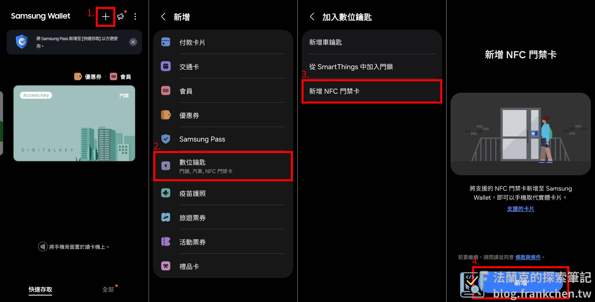
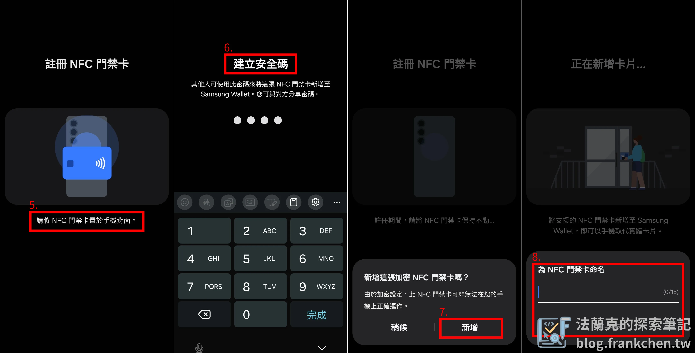

**Samsung Wallet 終於開放 NFC 門禁卡功能**！每天進公司或是回家，都要拿出對應的實體門禁卡才能進出辦公室或家裡。現在，可以把公司及家裡的實體門禁卡綁定到三星手機， 之後進出公司或家裡都能直接拿出手機來刷卡，就不用每次進出都要忙手忙腳。

接下來將帶你了解完整的資訊及綁定的方法，讓生活更便利！

## 哪些三星手機支援 NFC 門禁卡功能？

根據[三星官方公告](https://www.samsung.com/hk/support/mobile-devices/nfc-access-card/?srsltid=AfmBOoo1r2T8vcuz7EZ5VQJxzaYMxaliVeke84q5FRzDnnHI9ACHQ24n)，裝置的系統版本必須是 Android 15 以上，最保險的做法就是更新到含有「6月的安全性更新」版本，才能使用「NFC 門禁卡」功能，目前以下裝置支援：

-   Galaxy Z 系列：
    -   **Flip 系列**：Z Flip6、Z Flip5 5G、Z Flip4 5G、Z Flip3 5G
    -   **Fold 系列**：Z Fold6、Z Fold5 5G、Z Fold4 5G、Z Fold3 5G
-   Galaxy S 系列：
    -   **S25 全系列**：S25 Edge、S25 Ultra、S25+、S25
    -   **S24 全系列**：S24 FE、S24 Ultra、S24+、S24
    -   **S23 全系列**：S23 FE、S23 Ultra、S23+、S23
    -   **S22 系列**：S22 Ultra、S22+、S22 (**FE 版本尚未支援**)
    -   **S21 系列**：S21 Ultra、S21+、S21 (**FE 版本尚未支援**)
-   Galaxy A 系列：
    -   A36 (**唯一支援的A系列**)

可支援裝置會持續更新，如果未支援到的使用者，請隨時關注三星官方公告，如果我有發現更新，也會在這裡一併更新。

## 三星錢包門禁卡不能用怎麼辦？依症狀排查

不能用的情況大致分成四種，先找到自己是哪一種再往下看。

### 找不到「新增 NFC 門禁卡」選項

1.  先確認機型在上面的清單裡。清單外的機型，Wallet 裡不會出現這個選項。
2.  系統要 Android 15（One UI 7）以上。到「設定」→「軟體更新」更新到最新，含 2025 年 6 月以後安全性更新的版本比較保險。
3.  Samsung Wallet 要 `6.0.85` 以上，這是功能剛開放時的版本。現在到 Galaxy Store 直接更新到最新就好。
4.  系統和 Wallet 都是最新版還是沒有，先重新開機。再不行，到「設定」→「應用程式」找「**Samsung Wallet Digital Key**」，強制停止後重新打開 Samsung Wallet。

這個功能是三星分地區開放的，國外論壇有人回報同機型看不到選項。手上是水貨或海外版的話，找不到選項可能跟地區有關，不一定是設定問題。

### 卡片加不進去

-   加密過的門禁卡不支援。如果大樓或公司發的是加密卡，換手機、更新系統都沒用，只能問物業或管委會有沒有非加密的卡。
-   三星官方的說法是 Wallet 讀卡時會自己判斷這張卡能不能加入，不確定手上是哪一種卡，直接拿去加一次就知道。
-   一支手機最多放 8 張門禁卡，滿了要先刪掉不用的。

### 加進去了，但靠近讀卡機沒反應

-   NFC 要開著，而且三星官方要求 NFC 要設定成「**嵌入式安全元件**」。沒設對的話卡片加得進去，刷的時候卻沒反應。
-   螢幕關閉或上鎖時不能刷。要先把卡片叫出來：從畫面底部的快速存取向上滑，或打開 Wallet 的門禁卡頁面，再靠近讀卡機。
-   門禁卡是感應手機背面。保護殼太厚，或殼上有金屬片、卡夾，都可能讓讀卡機感應不到，拿掉殼試一次就能排除。
-   手機沒電時不能用。

### 系統更新後突然不能用

有網友回報更新到 One UI 7 之後卡片失效，原因是 NFC 的安全元件設定不見了。先回去確認上一段「嵌入式安全元件」的設定還在；還是不行，把卡片從 Wallet 刪掉再重新加入一次。

## 如何將實體門禁卡綁定到 Samsung Wallet 「NFC 門禁卡」？

根據以下步驟，即可將實體門禁卡綁定到 Wallet ：

進入「**Samsung Wallet**」，點擊右上角「**+**」—> 「**數位名片**」—>「**新增 NFC 門禁卡**」—>「**新增**」

接著將你的實體卡靠在手機背面，之後根據手機提示照著步驟走，即可完成綁定。

## 要如何使用「NFC 門禁卡」功能？

1.  開啟「Samsung Wallet」，選擇門禁卡後，就可以直接手機靠近讀卡機使用。
2.  從畫面底部向上滑叫出快速存取，選擇門禁卡後，就可以直接手機靠近讀卡機使用。螢幕關閉或上鎖時刷不了，一定要先把卡片叫出來。

## 「NFC 門禁卡」功能問題？

-   **支援哪些實體門禁卡**：支援 RFID 實體卡或感應磁扣，但並不支援加密過的實體卡。

-   **最多可以加幾張**：一支手機最多 8 張。

-   「NFC 門禁卡」功能需要**開啟 NFC** 嗎：需要，因為是靠著 NFC 來模擬門禁卡，而且要設定成「嵌入式安全元件」。

-   **無網路**可以使用「NFC 門禁卡」功能嗎：可以，這功能不需要使用到網路。

-   **沒有電了**可以使用「NFC 門禁卡」功能嗎：不可以，沒電情況下只能使用「悠遊卡」。

-   如果換手機了，**需要重新綁定嗎**：不需要，可以使用三星原廠提供的 Smart Switch Mobile 轉移到新手機。

盼了許久，終於等到三星開放了，有了「NFC 門禁卡」功能，之後進出大樓就不需要在手忙腳亂地找出實體門禁卡，直接「掏出手機，開啟門禁卡，靠卡感應，進門！」一氣呵成。
