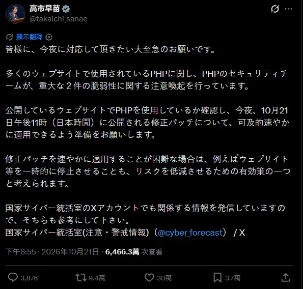
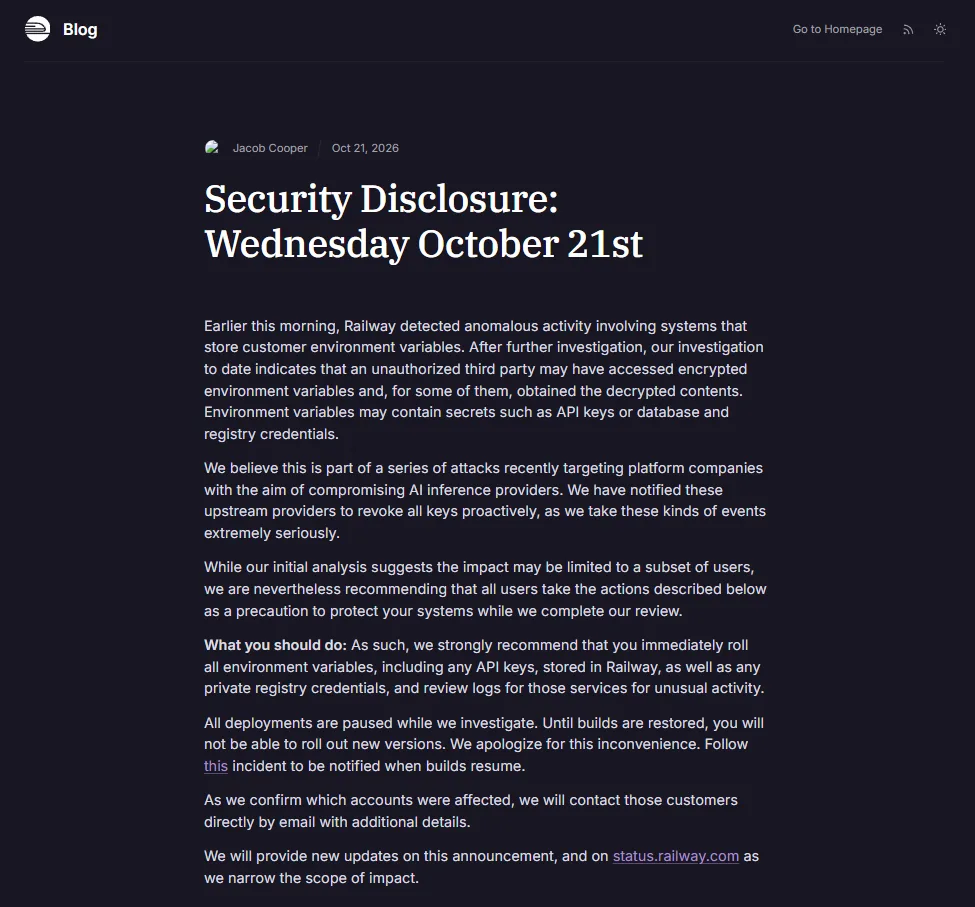

## 前言：10 月 21 日這一天

2026 年 10 月 21 日，以下時間都換成台灣時間，同一天發生了三件事：

- Node.js 發布 10 月安全更新，修了 10 個 CVE，其中 4 個是 High，包括一個可以遠端執行程式的 Brotli 解碼漏洞
- PHP 原本排定的安全更新，因為漏洞細節前一天就在 Hacker News 外洩，官方在 22:00 發布修補。發布前大約一小時（20:55），日本首相高市早苗在 X 上發了一則「今晚就要處理的大至急請託」
- Railway 公告偵測到異常活動，存放用戶環境變數的系統被存取，部分內容可能已被解密

先交代我的位置：這三件裡只有 Node.js 打到我。我沒有在跑的 PHP 服務（GitHub 上那幾個 PHP 專案只是舊備份），也沒有用 Railway。

所以這篇的寫法是這樣：Node.js 那段是我隔天早上實際盤點與修補的紀錄，PHP 和 Railway 我是旁觀者，只寫官方公告說了什麼，以及如果換成是我，應該怎麼做。

寫這篇的原因是，這三件事放在一起看，剛好是三種完全不同的狀況，每一種該做的事都不一樣。所以應變的第一步，是先認出自己遇到的是哪一種。

## 三件事，三種形狀

| | Node.js 安全更新 | PHP php2shell | Railway 外洩 |
|---|---|---|---|
| 漏洞在哪 | 執行環境（runtime） | 執行環境（runtime） | 別人的平台 |
| 誰負責修 | Node.js 官方，修正版同時推出 | PHP 官方，但細節比修補先曝光 | 平台方 |
| 你能做什麼 | 盤點版本、重建、驗證 | 搶時間：先緩解或停站，再更新 | 沒有東西可以修，只能輪替憑證、查異常 |
| 時間窗口 | 有預告，從容 | 被壓縮到幾小時 | 從你不知道的時候就開始了 |

第一種最常見，也最好處理：官方事先預告，修正版跟公告同時出來，你要做的是找出自己哪裡在跑受影響的版本，然後換掉。

第二種是最緊張的情況。修補還沒出來，攻擊者已經知道漏洞在哪。這時候「等修補」本身就是風險，你需要的是能馬上做的緩解措施，或乾脆先把服務停掉。

第三種最無力。你的程式碼沒有任何問題，但你放在平台上的秘密被拿走了。你沒有東西可以修補，只能假設它已經外洩，然後一把一把換掉。

下面一件一件講。

## Node.js 10 月安全更新：重點是版本，不是程式碼

### 公告說了什麼

[Node.js 官方公告](https://nodejs.org/en/blog/vulnerability/october-2026-security-releases)列了 10 個 CVE，修正版是 v26.12.1、v24.22.1、v22.23.4：

| CVE | 嚴重度 | 影響版本線 | 內容 |
|---|---|---|---|
| CVE-2026-111497 | High | 26、24、22 | Brotli 解碼越界寫入，可遠端執行程式 |
| CVE-2026-106069 | High | 26、24、22 | TLS 憑證主機名檢查繞過（主機名寬鬆解析成 IP） |
| CVE-2026-105483 | High | 26、24 | TLS 憑證主機名檢查繞過（IP 用全形數字寫） |
| CVE-2026-105482 | High | 26、24、22 | `dns.resolve` 遇到 NUL 字元會截斷名稱 |
| CVE-2026-105481 | Medium | 26、24、22 | keep-alive socket 會處理到請求送出前就寫入的回應 |
| CVE-2026-106072 | Medium | 26、24、22 | 非標準寫法的 IPv4 主機名，能讓 DNS 類型的憑證 SAN 拿來驗證 IP 端點 |
| CVE-2026-106074 | Medium | 26、24、22 | `crypto.randomUUID()`、`randomInt()` 的亂數快取被存進啟動快照與 SEA，每個行程產生相同的值 |
| CVE-2026-106073 | Low | 26、24、22 | Permission Model 可用 `fs.realpathSync` 繞過 |
| CVE-2026-106070 | Low | 26 | `ZipFile` 在 ZIP 標頭驗證失敗後回傳攻擊者可控的前綴位元組 |
| CVE-2026-106071 | Low | 26 | Permission Model 萬用字元比對造成檔案系統權限過度授予 |

另外同步更新了幾個內建依賴：c-ares、OpenSSL、Undici、SQLite（只有 22），以及根憑證（eMudhra 中繼 CA 被入侵）。

Brotli 那個最值得注意。`fetch()` 收到 `content-encoding: br` 的回應會自動解壓，所以只要你的 Node 程式會去抓外部網址，對方伺服器就有機會送一段惡意的壓縮資料過來。

另外有一句很容易被忽略：**已經停止維護的版本這次不修。** Node 20 在今年 4 月就停止維護了，還在跑 Node 20 的服務，這些漏洞會一直留著。

### 我怎麼盤點

10 月 22 日早上 9 點 27 分，我把公告連結丟給 Claude Code，請它用唯讀的方式掃過我所有的 GitHub repo 和服務。

repo 的部分，它用 GitHub API 讀了 137 個 repo（個人 94 個、公司 org 43 個）的檔案樹，沒有 clone 任何東西，先挑出有 `package.json`、`.nvmrc`、`Dockerfile`、CI 設定的，一共 62 個。接著逐一列出每個 repo 在哪裡指定了 Node 版本：`.nvmrc`、`engines`、`FROM node:xx`、CI 的 `node-version`。

結果跟我原本想的不一樣：**程式碼一行都不用改。**

這次的漏洞全部在 Node 執行環境本身，不在任何套件或程式碼裡。而我的 Dockerfile 大多寫成 `FROM node:22-alpine` 這種只鎖主版本的形式，重建時自然會拿到修正版。真正受影響的，是那些「已經 build 好、正在跑」的容器。

repo 掃描只抓到三個要處理的地方：

- 兩個舊專案的 Dockerfile 還是 `node:20-alpine`，一個專案的 `.nvmrc` 寫 20。Node 20 不會再修，有在跑就得升
- 一個專案的 `.nvmrc` 寫死 `22.22.2`，重建也不會變，要手動改

### 實際跑著的版本

接下來才是重點：每台機器上正在跑的 Node 到底是哪一版。這要直接連上主機看，Dockerfile 寫什麼不算數。

公司內網那台主機可以從我的公司筆電直接 SSH，家裡的伺服器和 Mac mini 公司這邊沒有金鑰，所以我在 Mac 上另外開了一個 Claude Code session，把要查的項目交給它。兩邊同時跑，最後結果回到同一個 session 彙整。

查法很單純，每個容器裡跑一次 `node -v`：

```bash
for c in $(docker ps --format '{{.Names}}'); do
  v=$(docker exec "$c" sh -c 'command -v node >/dev/null && node -v' 2>/dev/null)
  [ -n "$v" ] && echo "$c | $(docker inspect -f '{{.Config.Image}}' "$c") | node $v"
done
```

不是每個容器都有 Node，`command -v node` 那段是讓沒有 Node 的容器安靜跳過。

盤點結果：

| 位置 | 服務 | Node 版本 | 狀態 |
|---|---|---|---|
| 公司內網主機 | 6 個內部系統容器 | 22.23.2～22.23.3 | 受影響 |
| 家用伺服器 | 記帳服務前後端、SEO 監控 | 22.23.3 | 受影響，經 Cloudflare Tunnel 對外 |
| 家用伺服器 | 媒體庫 API 與背景任務 | 22.23.2 | 受影響，只在內網 |
| 家用伺服器 | n8n 2.31.3 | 24.16.0 | 受影響，對外公開 |
| Mac mini | Uptime Kuma 1.23.16 | 18.20.3 | 停止維護，不會修 |
| Mac mini | Discord bot | 跑在 bun 上 | 不在公告範圍 |
| 公司筆電 | 開發用 node | 24.13.0 | 受影響 |

自己寫的服務，修法都一樣：

```bash
docker compose build --pull && docker compose up -d
docker exec <容器名> node -v
```

`--pull` 不能省。沒加的話 Docker 會用本機快取的舊 base image，build 完還是舊版。官方的 `node:22-alpine` 在 10 月 21 日就已經換成 22.23.4 了。

驗證要看的是 `node -v` 的輸出，不是「build 成功」那行字。我的記帳服務除了看版本，還另外打了一次會查資料庫的 health 端點，確認重建後服務真的活著。

公司那台在 10 點前重建完，家裡那台 10 點 14 分回報完成。從看到公告到服務修完，大約 50 分鐘。

### 坑一：CD 不會幫你上安全更新

公司那幾個系統有接自動部署，push 到 main 就會重建上線。我原本以為這種的不用管。

但仔細想就知道不對：CD 只在程式碼有變動時才觸發。base image 出了安全更新，程式碼沒變，CD 就不會跑，線上的容器會一直停在舊版，直到下一次有人剛好 push。

所以這類公告出來，有接 CD 的服務一樣要手動重建一次。這件事我記進了公司的維運紀錄，下次遇到同類公告不用再想一次。

### 坑二：n8n 沒有修正版可以換

家裡伺服器上曝險最高的是 n8n。它對外公開，而且很多 workflow 會主動抓外部網址，Brotli 和 TLS 那幾個漏洞都碰得到。

問題是，n8n 用的是官方映像，裡面的 Node 版本不是我能決定的。我用 registry API 讀了最新版映像的設定（沒有 pull）：n8n 最新的 2.45.1，內建 Node 26.10.0，還是比修正版 26.12.1 舊。

也就是說，就算我現在把 n8n 從 2.31.3 一路升到最新版，扛一次跨 14 個 minor 的大版本升級，Node 的漏洞還是在。

這是用第三方映像最無力的地方：什麼時候能修，看的是 n8n 什麼時候發新版，不是我。

能做的只有兩件：

1. 縮小暴露面：盤點會去抓不受信任網址的 workflow，能先停的就先停
2. 確認哪些 CVE 真的適用：公告列的 8 個影響 24.x 的 CVE，不是每個都打得到 n8n

第二點我實際查了。CVE-2026-106073 只在開啟 Permission Model（`--permission`）時才會發生，CVE-2026-106074 只影響用了啟動快照或 SEA 打包成單一執行檔的程式。我原本「推定」n8n 都沒用到，但推定不算數，所以請 Mac 那邊的 session 去查 n8n 容器裡每個 node 行程實際的啟動參數：

```bash
docker exec n8n sh -c 'for p in /proc/[0-9]*; do
  c=$(tr "\0" " " < $p/cmdline 2>/dev/null)
  case "$c" in *node*) echo "$(basename $p): $c";; esac
done'
```

結果有兩個 node 行程，一個是 n8n 主程式，一個是 task runner（帶著 `--disallow-code-generation-from-strings` 這類旗標），都沒有 `--permission`，`NODE_OPTIONS` 也沒設。這兩個 CVE 確定不適用，剩下 6 個要等上游。

等上游出修正版這件事，我交給一個每天跑的提醒去追，有新版就通知我。

### 坑三：nvm 刪舊版，把 pm2 一起帶走

這個坑跟漏洞本身無關，但很可能你升級時也會踩到。

Mac mini 的開發用 node 我改用 nvm 統一管理，裝了 22.23.4 之後，把舊的三個版本刪掉。刪完一查，`pm2` 這個指令不見了。

原因是 `npm install -g` 裝的全域套件，是裝在當時那個 Node 版本的目錄底下。刪掉那個版本，pm2 就跟著消失。

更麻煩的是，當下完全看不出問題：記憶體裡的 pm2 daemon 還在跑，我的 Discord bot 照樣在線。但開機自動啟動的設定指向的是已經被刪掉的路徑，下次 Mac mini 重開機，所有 pm2 管的服務都不會起來，而且不會有任何錯誤訊息。

補救步驟：

```bash
npm install -g pm2
pm2 update      # 換掉記憶體裡舊版的 daemon
pm2 startup     # 會印出一行 sudo 指令，照貼執行
pm2 save
```

> 下次換版本，用 `nvm install <新版> --reinstall-packages-from=<舊版>`，全域套件會一起搬過去。確認 `pm2 startup` 指到新版之後，再刪舊版。

### 用 AI 跑盤點，我的做法

這次整個盤點大部分是 Claude Code 做的，我主要負責兩件事：決定範圍，以及按下會改變狀態的按鈕。

有幾個原則我覺得值得分享：

- **唯讀先跑完**：repo 用 API 讀檔案樹，主機只跑 `node -v`、`docker inspect` 這類指令。先把全貌看清楚，再決定要動什麼
- **改狀態的動作要人確認**：重建容器會中斷服務，我明確說了「重建」之後它才動手。家裡那台伺服器的規則更嚴，AI 預設只能跑診斷指令，要改東西得我在那個 session 裡親自確認
- **不讀秘密**：我交代過要查啟動參數的時候，環境變數只能印 `NODE_OPTIONS` 這一個，其他一律不印
- **結論要附依據**：「這個 CVE 不適用」這種話，一定要附上實查的輸出，推定的要標明是推定

137 個 repo 加三台主機，50 分鐘內盤點完，能修的服務也重建完，我自己手動做不到這個速度。但哪些可以動、哪些不行，還是要自己判斷。

## PHP php2shell：漏洞細節比修補先到

### 時間軸

以下依 [PHP 官方公告](https://www.php.net/archive/2026.php#2026-10-20-1)與 [Huntress 的整理](https://www.huntress.com/blog/php2shell-leaked-critical-php-vulnerabilities)，換算成台灣時間：

| 時間 | 發生什麼 |
|---|---|
| 10 月 20 日 | Hacker News 出現貼文，聲稱兩個 PHP 重大漏洞即將揭露。貼文被刪，但截圖已經流傳 |
| 10 月 21 日 03:33 | PHP 官方發布預告：10 月 21 日 14:00 UTC 發布安全更新，兩個漏洞都是 CVSS v4.0 9.2 |
| 10 月 21 日 20:55 | 日本首相高市早苗在 X 發文，請大家確認自己的網站有沒有用 PHP，今晚就準備好套用修補 |
| 10 月 21 日 22:00 前後 | PHP 8.5.12、8.4.27、8.3.36、8.2.35 發布 |
| 之後 | Cloudflare 回報觀測到針對這兩個漏洞的攻擊流量，包括試圖繞過它防護的請求 |

預告裡有一句話很關鍵：

> We reserve the right to release earlier should details of either vulnerability become public, or should evidence of active exploitation appear in the wild.

官方本來就保留「細節一旦曝光就提前發布」的權利。根據 [Huntress 引述 watchTowr 的說法](https://www.huntress.com/blog/php2shell-leaked-critical-php-vulnerabilities)，原本的協調揭露日是週四，外洩之後整個時程提前了。

### 兩個漏洞在講什麼

用白話講：

- **CVE-2026-109618（[GHSA-w8hw-w9fx-j79w](https://github.com/php/php-src/security/advisories/GHSA-w8hw-w9fx-j79w)）**：PHP 處理請求的過程中如果記憶體不足，可能在資料只初始化一半的時候被中斷，接著清理程序把這份殘缺的資料當成正常的處理，造成記憶體損壞
- **CVE-2026-109619（[GHSA-6wmf-4rv5-p3rp](https://github.com/php/php-src/security/advisories/GHSA-6wmf-4rv5-p3rp)）**：一個請求留下的內部狀態，在記憶體被釋放之後還殘留著。同一個 worker 處理下一個請求時，可能在重設之前就讀到它

兩個都可以讓沒有登入的攻擊者遠端執行程式。

影響範圍是「所有處理網頁請求的 PHP」：PHP-FPM、Apache mod_php、php-cgi、FrankenPHP、LiteSpeed 都在內。官方認為 mod_php 的風險最高，因為已經有人示範在任何應用程式碼執行之前，就能用一個未登入的請求觸發攻擊。

### 該怎麼更新

依你的狀況分三種：

1. **在支援中的版本（8.2～8.5）**：升到 8.5.12、8.4.27、8.3.36 或 8.2.35。Linux 發行版和 LTS 廠商事前就拿到了修補，先看你的套件來源有沒有更新。發行版的版本號可能不會變（修補是 backport 進去的），要看廠商公告確認
2. **用 `rpms.remirepo.net` 的人**：官方特別點名，這個志工維護的套件庫當天不會有更新，建議改用發行版套件或自己編譯
3. **8.1 以下**：官方已經不更新這些版本，但這次破例提供了 7.4、8.0、8.1 的最小 source backport，給自己編譯或沒有 LTS 廠商的人用。能升級就升級

另外一個要排進行事曆的：8.2 在 2026 年 12 月 31 日停止維護，這次的 8.2.35 是最後幾個安全更新之一。

### 來不及更新：官方的緩解措施

官方給了一組緩解措施，但講得很清楚：**這些只能降低特定攻擊路徑的風險，不會讓你的系統變安全。** 原話是：

> There are no complete mitigations, updating is the only safe choice.

針對記憶體不足那個（CVE-2026-109618）：

```ini
; 放在 php.ini、FPM pool 或 Apache 設定，用 php_admin_value 鎖住，讓應用程式改不了
memory_limit = -1
; 不需要上傳檔案的應用用 8M，需要的用 32M
post_max_size = 8M
; 要小於 post_max_size
upload_max_filesize = 6M
```

`memory_limit = -1` 看起來很反直覺：取消記憶體上限，不是更危險嗎？邏輯是這樣：漏洞是在「記憶體不足而中斷」時觸發的，取消 PHP 自己的上限，攻擊者就沒辦法用塞爆 `memory_limit` 的方式去觸發它。代價是要另外用容器或 cgroup 的記憶體上限當最後防線。官方特別提醒，不要改用 `RLIMIT_AS` 或 `RLIMIT_DATA`，那反而會造成漏洞要的那種配置失敗。

針對殘留狀態那個（CVE-2026-109619）：

```ini
; 必須在解析請求之前就生效：php.ini、FPM pool 或伺服器設定
session.upload_progress.enabled = 0
; 只有 PHP 8.5 需要
fatal_error_backtraces = 0
```

改完要重啟所有 worker。官方特別寫了：用 `ini_set()` 或 FPM 的 `.user.ini` 設定都沒有用，那時候請求已經解析完了。

除此之外，請求大小、欄位數、multipart 段數這些限制，最好在 web server 或反向代理那一層也擋一次。

### 首相那則貼文為什麼重要

一國首相在社群上針對單一軟體漏洞喊話，這件事本身就很少見。不過我在意的是她講了什麼。



截圖出處：[高市早苗的 X 貼文](https://x.com/takaichi_sanae/status/2112890642590564386)（擷取於 2026-10-22）

貼文大意是：這是一件「今晚就要處理的大至急請託」。PHP 的安全團隊針對兩個重大漏洞發出警示，請確認自己的公開網站有沒有用 PHP，並準備在日本時間 23 點修補發布後盡快套用。重點是倒數第二段：

> 修正パッチを速やかに適用することが困難な場合は、例えばウェブサイト等を一時的に停止させることも、リスクを低減させるための有効策の一つと考えられます。

意思是「如果很難馬上套用修補，暫時停止網站等服務，也是降低風險的有效手段之一」。

工程師都知道停站是選項，但要說服老闆停站很難。首相把它講出來，等於替所有要做這個決定的人背書。根據 [ITmedia 的報導](https://www.itmedia.co.jp/news/article/2610/22/2000002483/)，當晚日本有好幾個服務進入緊急維護，包括電商平台 BASE、遊戲《賽馬娘 Pretty Derby》與《Shadowverse: Worlds Beyond》，以及托育服務 CODMON。

修補還沒到、緩解措施又不完整的時候，停站是合理的選擇，不用覺得是認輸。

### 怎麼知道有沒有被打過

Huntress 給的偵測方向很實用：注意 PHP 的 worker 行程（`php-fpm`、`php-cgi`、`httpd`、`apache2`）有沒有生出不該有的子行程：

- shell：`sh`、`bash`、`cmd.exe`、`powershell.exe`
- 直譯器：`python`、`perl`
- 下載與網路工具：`curl`、`wget`、`nc`、`certutil.exe`
- 偵察指令：web server 跑了 `whoami`、`id`、`uname -a`

另外要保留 web server 和 PHP 的 log，檢查網站根目錄有沒有多出來的檔案、有沒有新的排程或帳號。

### 應變時只看官方公告

這段是給所有應變中的人的提醒。

事件剛爆發時，我先讀到的是一篇個人部落格的分析，它把其中一個漏洞評為 CVSS 5.3、說 PHP-FPM 碰不到。如果照那篇判斷，用 FPM 的人會以為自己沒事。

官方公告的說法正好相反：9.2 分，FPM 明列在受影響範圍裡。

事件剛發生時，網路上的資訊一定很亂，有人搶快、有人推測、有人寫錯。修補範圍、版本號、緩解措施，一律以官方公告和 GitHub 上的 advisory 為準，其他的只能當參考。

## Railway：秘密在別人手上時，你能做的只有輪替

### 截至 10 月 22 日已知的事

依 [Railway 10 月 21 日的公告](https://blog.railway.com/p/security-disclosure-wednesday-october-21st)：

- 偵測到「與存放用戶環境變數的系統有關的異常活動」
- 未經授權的第三方可能存取了加密的環境變數，其中一部分可能已被解密
- 範圍「可能限於部分用戶」，確認受影響的帳號會直接收到 email
- 所有部署暫停，暫時無法上新版本
- Railway 認為這是一連串針對平台公司的攻擊之一，目標是 AI 推論服務商，已經通知上游服務商主動撤銷金鑰



截圖出處：[Railway — Security Disclosure: Wednesday October 21st](https://blog.railway.com/p/security-disclosure-wednesday-october-21st)（擷取於 2026-10-22，後續更新以該頁為準）

給所有用戶的建議是：立刻輪替存在 Railway 上的所有環境變數（含 API key）、輪替私有 registry 的憑證、檢查這些服務的 log 有沒有異常。

根本原因和受影響人數，公告都還沒說。

### 官方隔天補的那串文章，就是一份清冊

10 月 22 日，Railway 部落格一口氣發了一整串「建議」文章，每篇講一種東西怎麼檢查或輪替：

- 檢查 GCP、AWS、GitHub 有沒有異常存取
- 輪替 MySQL、Redis、MongoDB、PostgreSQL 的連線憑證
- 檢查 Stripe、OpenAI、Anthropic、OpenRouter、Grok 有沒有不明用量
- 憑證重設後重新部署 Buckets、重新連結 GitHub

我覺得這串文章比公告本身更有用，因為它剛好列出了「一個典型的 PaaS 用戶，環境變數裡會放哪些東西」。就算你不是 Railway 用戶，拿這份清單對自己的平台一項一項問：我放了嗎？放在哪？多久沒換了？

### 兩個月內第二家

8 月和 10 月，Zeabur 兩度被入侵，之後宣布年底停止營運。現在輪到 Railway。我在〈[從 Zeabur 兩次資安事件學到的事](/zeabur-incident-permission-blast-radius/)〉寫過的順序，這次一樣適用：

1. **先止血**：到 AI 服務商後台設支出硬上限，選「超過就停用」。這是五分鐘就能做完、又能馬上壓住損失的動作
2. **再撤銷**：到各服務商撤銷舊金鑰。在平台上改掉環境變數，不會讓舊的金鑰失效，這是兩件事
3. **最後查持久化**：拿著你雲端憑證進去過的人，可能已經建了新的帳號、金鑰或排程。Railway 那幾篇 GCP、AWS、GitHub 的檢查文，就是在處理這一步

Railway 這次的公告寫的是「may」，範圍「可能」有限。我的建議跟上次一樣：沒收到通知信，也照樣輪替。Zeabur 第二次事件的第一則公告，四個多小時後就擴大了範圍。

### 如果換成是我

我沒有用 Railway。但 10 月 21 日我剛好做完一輪機密盤點（就是我 8 月寫 Zeabur 那篇時承認還沒做的那份清冊），刪掉了 4 支不再用的 Cloudflare token、29 筆沒有任何 workflow 引用的 n8n credential。

做完之後最大的差別是：如果明天換我的平台出事，我知道要換哪幾把、去哪裡換。在那之前，我答不出來。

## 預防：平常就該做好的四件事

### 一、版本與服務的清冊

這次能在 50 分鐘內盤完，最大的原因不是 AI，是我早就有一份基礎設施清冊：哪台機器跑什麼服務、怎麼連、哪些對外。AI 拿著這份清單才知道要去哪裡查。

如果你現在被問「你有幾個服務在跑 Node 22？」，答不出來的話，先從這裡開始。不需要什麼工具，一個表格就夠：

| 服務 | 在哪台 | 執行環境與版本 | 對外程度 | 怎麼更新 |
|---|---|---|---|---|

最後一欄最常被忽略。「怎麼更新」寫的是：自己 build 的、官方映像、還是套件管理器裝的。這決定了公告出來時，你能不能自己修。

### 二、訂閱公告管道

新聞和社群轉貼一定比原始公告晚。要搶到準備時間，就直接訂閱來源：

- Node.js：[nodejs-sec 郵件群組](https://groups.google.com/g/nodejs-sec)，安全更新前會先發預告
- PHP：[php.announce](https://news-web.php.net/php.announce)，這次的預告就是從這裡發的
- 你用的每一個平台的 status page

PHP 這次從預告到發布不到 20 小時。如果你是看新聞才知道，可能已經錯過「準備」那段時間了。

### 三、讓重建只要一行指令

這次 Node 的修補之所以輕鬆，是因為大部分專案都可以 `docker compose build --pull` 一行搞定。要維持這個狀態，有兩件事：

- base image 只鎖主版本（`node:22-alpine`），不要鎖到 patch 版本（`node:22.22.2-alpine`）。鎖死的版本永遠不會自己更新
- `.nvmrc` 也一樣。我有一個專案寫死 `22.22.2`，這次就得手動改

鎖主版本的代價是可重現性比較差，同一份 Dockerfile 隔一個月 build 出來的 Node 版本可能不同。這是取捨，以我的規模，能快速拿到安全更新比較重要。

### 四、定期盤點停止維護的版本

這次掃出來的停止維護版本：

- Node 20：兩個舊專案的 Dockerfile
- Node 18：Uptime Kuma 1.x 內建的，1.x 不會再更新
- Node 25：Mac 上 Homebrew 裝的開發用 node。奇數版只有半年支援，早就停了
- PHP 8.1 以下：官方這次給了 backport，下次不一定會有
- PHP 8.2：12 月 31 日停止維護

停止維護的版本，平常感覺不出差別，一出事就是「沒有修正版可以換」。最好的時機是在沒事的時候升級，而不是等到有漏洞時才被迫跳好幾個大版本。

## 應變：公告出來之後的六步

把前面的內容收成一份檢查清單：

1. **判斷是哪一種形狀**：預告過的更新、細節比修補先到、還是秘密在別人手上？這決定你接下來要搶時間還是按部就班
2. **盤點受影響的地方**：看正在跑的版本，不是看程式碼或 Dockerfile。runtime 漏洞要每台機器、每個容器實際跑 `-v`
3. **能修就修，不能修就緩解或暫停**：有修正版就重建或更新；沒有的（像 n8n）先縮小暴露面；細節已經外洩、修補還沒到的，停站是正當的選項
4. **驗證實際結果**：看 `node -v`、`php -v` 的輸出，再打一次會走到資料庫的端點，不要看「重建成功」就算數
5. **查有沒有被打過**：PHP 看 worker 有沒有異常子行程；平台外洩看雲端帳號有沒有不明的使用者、金鑰、排程
6. **記錄並追蹤還沒修的**：今天修不了的（n8n 等上游、Uptime Kuma 等 2.x），要有一個會提醒你的東西，不然一定會忘

## 常見問題

**php2shell 影響哪些 PHP 版本？**

所有處理網頁請求的 PHP 都受影響，修正版為 8.5.12、8.4.27、8.3.36、8.2.35，8.1 以下官方不再更新。

**我用 PHP-FPM，需要更新嗎？**

需要，官方明列 PHP-FPM 在受影響範圍內，mod_php 風險最高，但 FPM 一樣要更新。

**來不及更新 PHP 可以怎麼辦？**

在 php.ini 或 FPM pool 關閉 session.upload_progress 並重啟 worker，必要時暫停服務，但都不能取代更新。

**Node 20 這次會修嗎？**

不會，Node 20 已停止維護，這次只修 22、24、26 三條版本線，還在用 Node 20 要升到 22 以上。

**Docker 裡的 Node 要怎麼更新？**

用官方映像自己 build 的，跑 docker compose build --pull 再 up -d，最後用 node -v 確認版本。

**我沒有用 Railway，需要做什麼嗎？**

把 API key 放在任何平台環境變數裡都有同樣風險，最低限度是去 AI 服務商後台設支出硬上限。

**用的第三方映像還沒出修正版怎麼辦？**

先確認哪些 CVE 真的適用，再縮小對外暴露面，並設提醒追蹤上游發布，有修正版就升。

## 結語

這三起事件裡，我真正動手的只有 Node.js，而且最難的部分不是修，是找出「哪裡在跑」。

PHP 那件讓我想到，應變時間從來不是你決定的。這次細節外洩，官方只能提前發布，從預告到修補不到 20 小時。Railway 那件則是另一個極端：你從頭到尾都沒有東西可以修，只能假設秘密已經外洩。

三種狀況要做的事不同，但有一點一樣：出事當天能做的，大多是平常就準備好的。清冊、訂閱公告、能一行重建、不留停止維護的版本，這四件都沒辦法等出事當天才做。

留一題給你：

> 如果明天又有一個 runtime 漏洞，你需要多久才能說出「我有哪幾個服務受影響」？

## 參考資料

Node.js：

- [Node.js — October 2026 Security Releases](https://nodejs.org/en/blog/vulnerability/october-2026-security-releases)：CVE 清單與修正版本

PHP：

- [PHP — 2026 News Archive](https://www.php.net/archive/2026.php#2026-10-20-1)：10 月 20 日預告與 10 月 21 日安全公告，緩解措施出自這裡
- [GHSA-w8hw-w9fx-j79w](https://github.com/php/php-src/security/advisories/GHSA-w8hw-w9fx-j79w)、[GHSA-6wmf-4rv5-p3rp](https://github.com/php/php-src/security/advisories/GHSA-6wmf-4rv5-p3rp)：兩個漏洞的完整技術細節
- [Huntress — php2shell: Leaked Critical PHP Vulnerabilities](https://www.huntress.com/blog/php2shell-leaked-critical-php-vulnerabilities)：外洩時間軸與偵測方向
- [Qualys — PHP2Shell: PHP Patches Two Critical RCE Vulnerabilities](https://blog.qualys.com/vulnerabilities-threat-research/2026/10/20/php-announces-critical-security-release-for-two-vulnerabilities)：Cloudflare 觀測到攻擊流量、FPM 受影響的說明
- [CERT-EU — Critical Vulnerabilities in PHP](https://cert.europa.eu/publications/security-advisories/2026-018/)
- [高市早苗的 X 貼文](https://x.com/takaichi_sanae/status/2112890642590564386)：10 月 21 日台灣時間 20:55 發布
- [ITmedia NEWS — 高市総理「大至急、PHPパッチ適用を」Xで異例の要請](https://www.itmedia.co.jp/news/article/2610/22/2000002483/)：日本企業當晚的緊急維護

Railway：

- [Railway — Security Disclosure: Wednesday October 21st](https://blog.railway.com/p/security-disclosure-wednesday-october-21st)
- [Railway Blog](https://blog.railway.com/)：10 月 22 日起的檢查與輪替建議系列

我自己的相關文章：

- [從 Zeabur 兩次資安事件學到的事：一把金鑰能走多遠？](/zeabur-incident-permission-blast-radius/)
- [Zeabur 結束營運搬家：我用 Claude Code 把 8 個服務搬出 Zeabur 的實際流程](/zeabur-shutdown-migration-guide/)
