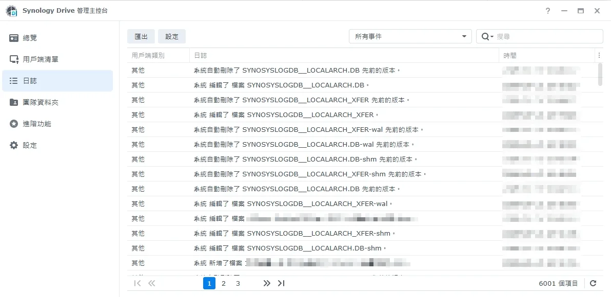
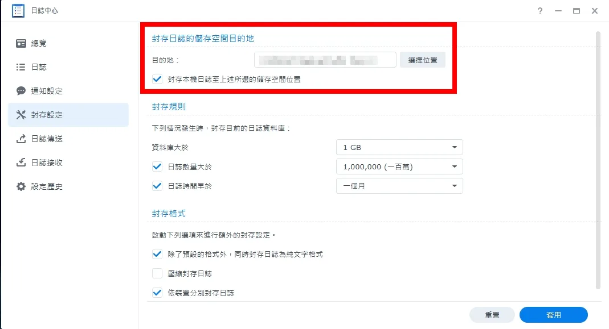

## 前言：跑了一個多小時，處理數還是 0

公司內部有一套我自己做的檔案搜尋系統，NAS 上大約 10 萬份檔案。今天上午，新的抽取程式上線，開始跑第一輪。

第一輪的做法是先走訪整台 NAS，把每份檔案排進工作佇列，排完才開始真正抽取內容。排程時每份檔案都要跑一次 `file --mime-type` 判斷類型，所以要實際讀 NAS。

85 分鐘過去，只排了 1.7 萬份，大約每分鐘 200 份，處理數一直是 0。照這個速度，光排程就要 6 到 12 小時。

這篇記錄我怎麼從「一定是我的程式寫爛了」，一路查到真正原因是 Synology Drive 一直在幫日誌中心的封存資料庫存版本。看完你會知道：

- 怎麼確認 NAS 是不是被別的東西讀滿
- 怎麼用「停掉其中一方」做對照實驗
- 兩段可以直接在 DSM 上跑的指令，找出是哪個行程在讀硬碟

環境：Synology DS1522+（Ryzen R1600、8GB 記憶體），4 顆 5,900 轉的 3TB 硬碟組 RAID5，M.2 槽空著。主機透過 SMB 3.1.1 掛載 NAS，1GbE，延遲 0.25ms。

## 直覺錯了：先懷疑自己

這次是我跟 Claude Code 一起排查。Claude 從主機端遠端量測，我負責 NAS 管理介面的操作。

第一輪量到的數字長這樣：

| 項目 | 結果 |
|------|------|
| 開檔 | 2ms |
| 讀 4KB | 73ms |
| 讀 1MB | 98ms |
| `file --mime-type` 每份 | 200 到 300ms |
| 平行跑 8 支 | 沒有改善 |
| 循序讀取 | 36MB/s |

我們兩邊的第一個反應都是自己出問題。先懷疑 SMB 掛載參數 `rsize=4MB` 讓每次讀取抓太多，接著我開了一場設計討論，準備把「先排完再抽」改成「邊排程邊抽取」，至少不要讓處理數一直掛零。

現在回頭看，答案其實已經在表格裡了。讀 4KB 要 73ms，讀 1MB 也才 98ms，循序讀還有 36MB/s，表示頻寬沒問題，慢的是每一次讀取都在排隊。這是另一頭的硬碟磁頭忙不過來的樣子，跟我的程式怎麼寫沒什麼關係。當下兩邊都沒看出來。

## 去量對的地方：NAS 本身

既然主機端量不出所以然，就去 NAS 上量。我開了一個唯讀帳號給 Claude，讓它 SSH 進去看磁碟狀態：

- iowait 92.6%
- 每顆硬碟大約每秒 310 次讀取
- RAID 陣列 md2 的佇列堆到上千

5,900 轉的硬碟，每秒三百多次隨機讀取已經是極限，硬碟確實被讀滿了。問題是誰在讀。

關鍵是下一步：把我自己的抽取容器暫停，再量一次。NAS 的讀取還是每秒約 1,265 次，同一時間主機透過 SMB 發出的讀取每秒只有 3 次左右。

所以硬碟滿載不是我造成的，`rsize` 的推論可以收回了。

> 「我的程式很慢」跟「我的程式造成慢」是兩件事。把自己停掉量一次，就分得出來。

我之前查[中華電信下載 GitHub 很慢](https://www.frankchen.tw/hinet-github-slow-cloudflare-warp/)時，缺的也是這個對照組。

## 縮小範圍：延後 Drive 索引

找方向的時候，我在 DSM 上剛好看到 Synology Drive 管理主控台的狀態寫著「正在索引… 剩餘 17 個檔案」，旁邊有個「延後 1 小時」的按鈕。

才 17 個檔案，看起來沒什麼。我還是按下去試試，結果：

| 狀態 | md2 每秒讀取次數 | 排程速度 |
|------|----------------|---------|
| Drive 索引進行中 | 840 | 每分鐘約 200 份 |
| 延後 Drive 索引 | 86 到 92 | 每分鐘約 1,000 份 |
| 手動恢復 Drive | 782 到 801 | 20 秒內數字不動 |

延後一按，讀取量剩十分之一，排程快了五倍；一恢復又打回原形。可以確定跟 Drive 有關。

不過「剩餘 17 個檔案」這個數字很奇怪，17 個檔案不可能讓硬碟忙一個多小時。後來才知道，這 17 個檔案一直在重複出現。

## 找出是誰在讀：中間走了好幾條死路

知道跟 Drive 有關還不夠，要知道它在讀什麼。這段走了不少冤枉路，我照實寫，因為你在 DSM 上排查大概也會撞到。

第一關是權限。唯讀帳號看不到 root 行程開了哪些檔案，所以改成 Claude 寫指令、我用管理員帳號在 SSH 上 sudo 執行，再把輸出貼回去。

死路一：DSM 沒有 `pgrep`。

```
sh: pgrep: command not found
```

只好改成掃 `/proc/*/cmdline`，用指令名稱比對出 Drive 相關的行程。

死路二：去看 Drive 行程開著的檔案，只看到 Drive 自己的 SQLite 資料庫和 log。後來才想到，那時候 Drive 還在「延後」狀態，看到的當然只有它自己。

恢復 Drive 之後，改用 `/proc/<pid>/io` 裡的 `read_bytes`，量 10 秒內每個行程讀了多少：

| 行程 | 10 秒讀取量 | 是誰 |
|------|-----------|------|
| smbd | 169.8MB | 我的抽取程式透過 SMB 讀影片檔 |
| syno-cloud-clientd | 95.6MB | Synology Drive |

這裡要注意，smbd 讀的量雖然大，但那是循序讀大檔，對硬碟來說輕鬆；Drive 的讀取才是把佇列塞滿的那一方。

死路三：看 `syno-cloud-clientd` 開著的檔案，連看三次都沒有使用者檔案，只有 6 個 `@tmp/clientd.tmp.dir/` 底下的暫存檔。看起來是讀完就關，每次去看都剛好錯過。

死路四：想看 Drive 資料夾有多大，`du -sh` 下去直接卡死，硬碟已經滿載，又有大量版本檔要走訪。改用 `ls -l` 只看資料庫檔，最大才 264MB，資料庫本身被隨機讀爆這個猜測也排除了。

這時候我已經開始往硬體想：加記憶體、M.2 插 NVMe 當 SSD 快取。差一點就要為一個還沒找到原因的問題花錢。

## 真相：Drive 在幫日誌中心存版本

最後是我打開 Drive 管理主控台的「日誌」頁面才看到。6,001 筆紀錄裡，幾乎全是這兩種：

- 系統 編輯了 檔案 SYNOSYSLOGDB__LOCALARCH.DB
- 系統自動刪除了 SYNOSYSLOGDB__LOCALARCH_XFER 先前的版本

每幾秒一筆，中間只夾著少數真正的使用者檔案。



仔細看，被版本化的不只資料庫本體，連 `-wal`、`-shm` 也在裡面。這兩個是 SQLite 的預寫日誌和共享記憶體檔，資料庫每寫一次就會跟著變，兩份資料庫加起來共 6 個檔案輪流被 Drive 重讀、存版本、刪舊版。

`SYNOSYSLOGDB__LOCALARCH` 開頭的檔案是 DSM「日誌中心」的封存資料庫，XFER 那份是檔案傳輸紀錄。我當初設定封存位置時，隨手選了管理員帳號的 home 資料夾，而 home 開了 Synology Drive（也就是 Drive 裡的「我的檔案」）。

兩個設定各自都很合理：日誌要封存，home 要同步。疊在一起就變成一個循環：

```
1. 日誌中心每幾秒寫一次封存資料庫
2. Drive 把它當成使用者改了檔案：整份重讀、存新版本、刪舊版本
3. Drive 的動作和 SMB 讀檔又產生新的日誌（推測）
4. 回到第 1 步
```

第 3 步是我的推測，我沒去確認 XFER 是否記錄 SMB 的讀取事件。不過時間點對得上：舊的索引工具前一天開始全量重掃，今天新程式又要走訪 10 萬份檔案，如果每次讀檔都會留紀錄，日誌寫入量自然暴增，循環就越轉越快。

整個過程沒有任何錯誤訊息。DSM 不會告訴你 Drive 在版本化日誌，Drive 也只顯示「剩餘 17 個檔案」。

## 修正與結果

修法很簡單：把日誌中心的封存位置移到一個沒開 Drive 的共用資料夾。

位置在 DSM 主選單 → 日誌中心 → 封存設定 →「封存日誌的儲存空間目的地」，按「選擇位置」換掉目的地，再按套用。



15:05 再量一次，md2 每秒讀取剩 40 到 62 次，排程已經跑到 95,500／102,467。

先前開的設計討論收掉，程式一行都沒改。

## 結語：三件我會記住的事

先量瓶頸再改程式。這次如果照第一直覺改成「邊排程邊抽取」，改完一樣慢，還會多一份要維護的複雜度。

用「停掉其中一方」做對照。暫停自己的程式、延後 Drive，各做一次，比盯著任何監控圖都快。

兩個各自合理的設定疊在一起，可能會出事，而且不會報錯。日誌封存、home 同步，單獨看都沒問題。如果你的 NAS 也開了 Drive，建議花一分鐘確認：日誌中心的封存位置、各種備份或匯出的目的地，有沒有落在 Drive 同步的資料夾裡。

### 可複製的排查指令

以下兩段要在 DSM 上用管理員帳號 sudo 執行。

找出 10 秒內讀取量最大的前五個行程，並列出第一名開著的檔案：

```bash
sudo sh -c 'snap(){ for d in /proc/[0-9]*; do echo "${d#/proc/} $(cat $d/comm 2>/dev/null) $(grep ^read_bytes $d/io 2>/dev/null | cut -d" " -f2)"; done; }; snap > /tmp/io1; sleep 10; snap > /tmp/io2; join /tmp/io1 /tmp/io2 | awk "{d=\$5-\$3; if(d>0) printf \"%8.1f MB  %s %s\n\", d/1048576, \$1, \$2}" | sort -rn | head -5 | tee /tmp/iotop; p=$(head -1 /tmp/iotop | tr -s " " | cut -d" " -f4); echo "--- $p 開著的檔案:"; ls -l /proc/$p/fd | grep -o "/volume.*" | grep -v "@synologydrive\|@SynologyDrive" | head -30'
```

列出 Drive 與索引相關行程開著的檔案（DSM 沒有 `pgrep`，所以改掃 `/proc`）：

```bash
sudo sh -c 'for d in /proc/[0-9]*; do c=$(tr "\0" " " < $d/cmdline 2>/dev/null); case "$c" in *SynologyDrive*|*fileindexd*|*synoindex*) ls -l $d/fd 2>/dev/null | grep -o "/volume.*" | sed "s|^|$(cat $d/comm)  |";; esac; done | sort -u'
```

使用限制：

- `read_bytes` 算的是行程層級的累計量，讀完就關檔的行程（像這次的 Drive）在 fd 清單裡抓不到，要搭配讀取量一起看
- 讀取量大不等於罪魁禍首，循序讀大檔對硬碟的負擔遠小於大量隨機讀
- 硬碟滿載時別對大資料夾跑 `du`，會卡住
